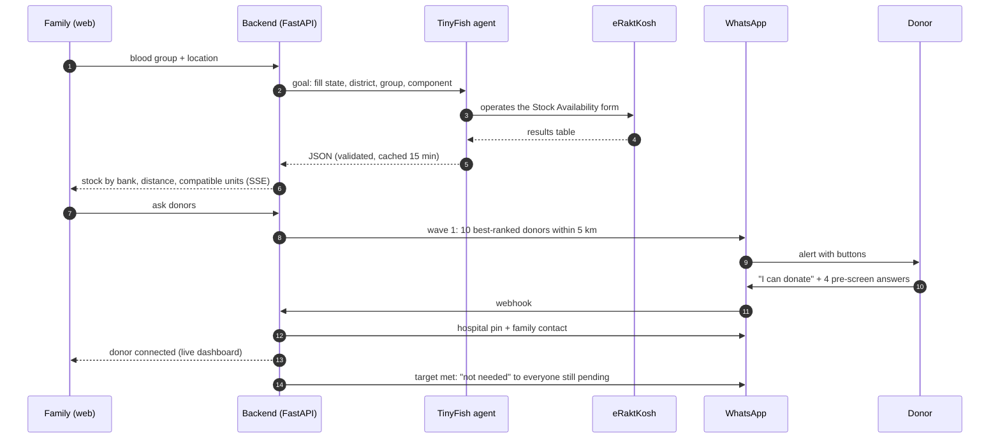
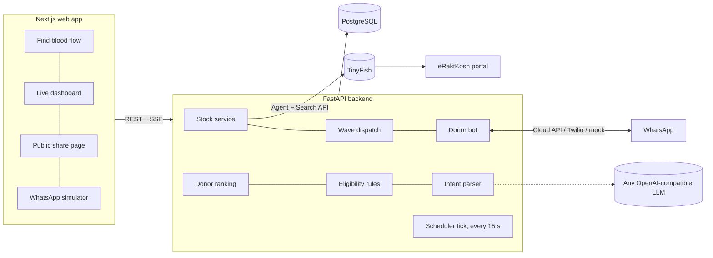
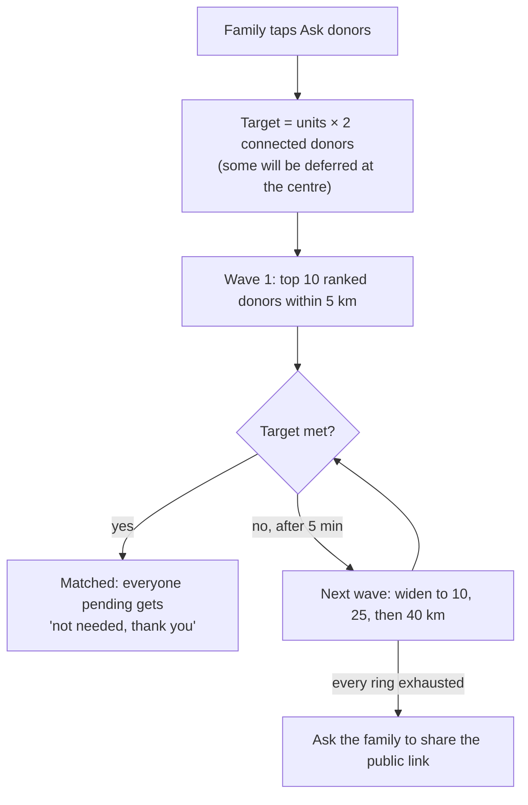
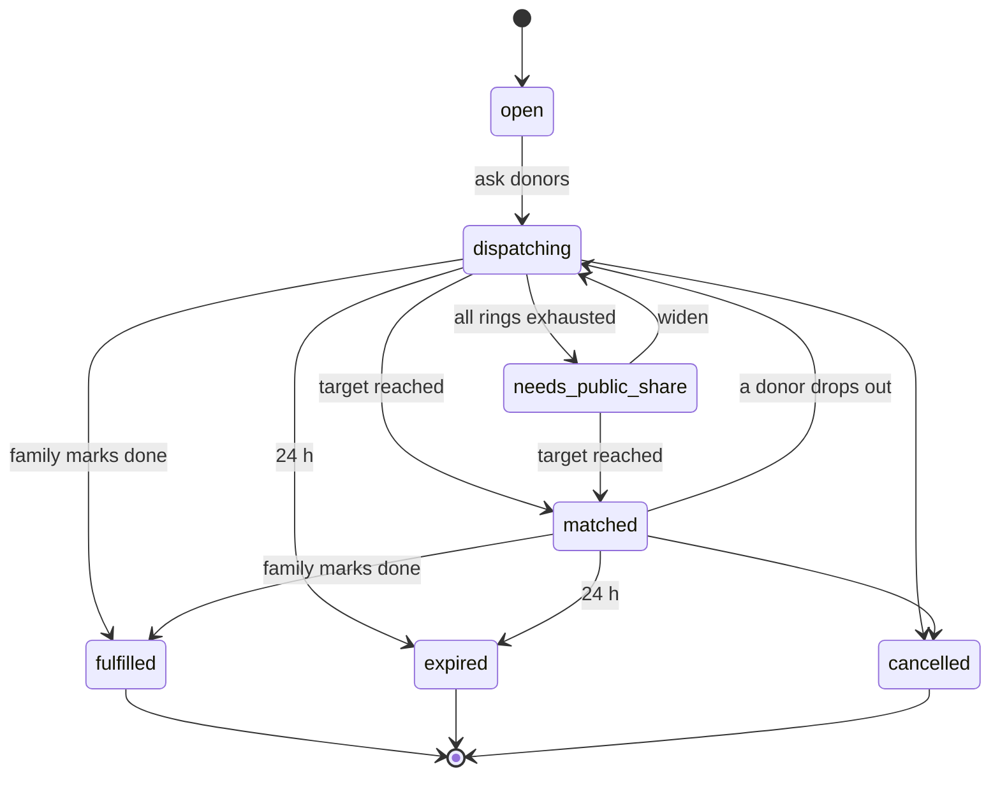

# Rakt Doot (रक्त दूत)

**Find blood in an emergency: live blood-bank stock first, nearby WhatsApp donors next.**

> We turned a government website into an API, and WhatsApp into a donor network.

When someone needs blood urgently in India, families end up begging on Instagram and forwarding pleas across WhatsApp groups. The data to help them already exists: **eRaktKosh**, the government blood-stock portal, knows which blood bank has stock, and lakhs of people are willing to donate. But the portal has no API, and donors have no organised way to be reached.

**Rakt Doot** is a phone-first web app that closes both gaps. A family member opens one page, picks the patient's blood group, and sees live stock at nearby blood banks, pulled from eRaktKosh by a **TinyFish** web agent. If nothing close has stock, one tap alerts nearby donors on **WhatsApp**, but only those who are compatible, eligible today and not in their rest period. Donors never install an app, and they are never spammed.

Built by team **Pookie Blinders** (Kartik Tiwari, Utkarsh Singh, Raaghav Kapoor) for **Azinhack 2026**, IoSC, USAR GGSIPU. Track: AI Engineering. Sponsor tech: TinyFish.


---

## Contents

1. [The problem](#the-problem)
2. [How it works](#how-it-works)
3. [Architecture](#architecture)
4. [Quick start](#quick-start)
5. [Setup guide for teammates](#setup-guide-for-teammates)
6. [TinyFish integration](#tinyfish-integration)
7. [Where the AI is](#where-the-ai-is)
8. [Implementation details](#implementation-details)
9. [API reference](#api-reference)
10. [Project structure](#project-structure)
11. [Safety, privacy and legal](#safety-privacy-and-legal)
12. [Future scope](#future-scope)

---

## The problem

| Gap | What is wrong today |
|---|---|
| **Information** | eRaktKosh lists real-time stock for 3,800+ registered blood centres, but it has no public API and a desktop-era form that nobody in a hospital corridor knows how to use. |
| **Connection** | Willing donors exist but cannot be targeted. Social-media pleas don't filter by blood group, distance or eligibility, and forwards keep circulating for weeks after the patient has been helped. |
| **Geography** | 74 districts had no blood bank at all in 2016-17 (IndiaSpend). In eight northern states, only about 61% of people live within an hour of one (2024 geospatial study using eRaktKosh data). |

India needs an estimated **14.6 million units** of blood a year (NBTC-commissioned study), against about **11.1 million** collected in 2016-17.

---

## How it works

**Family (phone browser, no install):**
1. Tap **Find blood now**, pick the blood group, share your location or search for the hospital.
2. A TinyFish agent reads eRaktKosh for that district. The page shows usable units for the patient's group and every compatible group, on a range map around the hospital.
3. If nothing close has stock, tap to ask donors. Fill in four fields, check the auto-written request (compatible groups are worked out for you) and send it.
4. A live dashboard shows how many donors were messaged, delivered, seen, replied and connected. A donor's number appears only after they accept and pass the health pre-screen.

**Donor (WhatsApp only):**
1. Send `JOIN` and answer eight short questions, once.
2. When someone nearby needs your group, you get one message with **I can donate** / **Not today** buttons.
3. After accepting, answer four yes/no health questions. If you pass, you get the hospital's location and the family's number.
4. After donating, you are silenced for your rest period (90 days for men, 120 for women) and told when you can donate again. `STOP` and `PAUSE 30` work at any time.



---

## Architecture

### System



### How Docker runs it

`python run.py` starts three containers from [docker-compose.yml](docker-compose.yml):


- `db` starts first. The backend waits until Postgres reports **healthy**.
- On first start the backend creates the tables and seeds **17 Delhi NCR blood banks** and **200 synthetic donors**.
- Data lives in the `pgdata` volume, so it survives restarts. `python run.py --reset` wipes it.

| Layer | Choice |
|---|---|
| Frontend | Next.js 16 (App Router), React 19, plain CSS design tokens, self-hosted fonts, English and Hindi |
| Backend | Python 3.12, FastAPI, SQLAlchemy 2, Uvicorn |
| Database | PostgreSQL 16 (Docker). The same schema also runs on SQLite, which the test suite uses. |
| Web agent | TinyFish Python SDK: Agent API with SSE streaming, Search API |
| Messaging | WhatsApp Business Cloud API, Twilio WhatsApp sandbox, or mock mode with a web simulator |
| LLM | Any OpenAI-compatible chat endpoint returning JSON, with keyword rules as the fallback |
| Geocoding | OpenStreetMap Nominatim, with an offline fallback |

---

## Quick start

You need **Docker Desktop** and **Python 3** (Python only runs the launcher script).

```bash
git clone <this-repo-url> rakt-doot
cd rakt-doot
python run.py
```

| Open | What it is |
|---|---|
| http://localhost:3000 | The app |
| http://localhost:3000/simulator | Plays any donor's WhatsApp, for demos without a real WhatsApp account |
| http://localhost:3000/admin | Team controls (token: `change-me` by default) |
| http://localhost:8000/docs | Interactive API docs (Swagger) |

Press **Ctrl+C** to stop. The containers stop and your data is kept.

No API keys are needed. Without keys, the app runs end to end in demo mode: clearly labelled sample stock, synthetic donors and mock WhatsApp.

---

## Setup guide for teammates

### 1. First run

```bash
python run.py            # builds images (a few minutes the first time), then starts everything
```

`run.py` starts Docker Desktop if it isn't running, then runs `docker compose up --build`. You're ready when the log shows:

```
backend-1   | INFO:     Application startup complete.
frontend-1  | ✓ Ready
```

### 2. Try the whole flow in 2 minutes

Open two browser windows side by side.

1. **Window A:** http://localhost:3000, then **Find blood now**. Pick `B+` and search for `AIIMS`.
2. Sample stock appears. Tap **Ask nearby donors**, fill in the form (any valid 10-digit mobile number), then **Send to donors**.
3. You land on the **live dashboard**: 10 donors are messaged in wave 1.
4. **Window B:** http://localhost:3000/simulator. The donors who just got the alert are at the top. Open one, tap **I can donate**, then answer **No** to all four health questions.
5. Back in Window A, the donor shows as **connected**, with their number revealed.
6. In `/admin` (token `change-me`), **Pretend 3 hours passed** sends the "are you on your way?" message. **Pretend 25 hours passed** sends "did you donate?".

> **Demoing at night?** Between 11 pm and 7 am, only donors who opted in to night alerts are messaged, so waves can be tiny. Put `RESPECT_QUIET_HOURS=false` in `.env` and restart.

### 3. Configuration (`.env`)

Every key is optional. Copy the example and fill in only what you need:

```bash
cp .env.example .env     # Windows PowerShell: Copy-Item .env.example .env
```

| To switch on | Set in `.env` |
|---|---|
| Live eRaktKosh stock | `TINYFISH_API_KEY` |
| Real WhatsApp (Meta) | `WHATSAPP_MODE=cloud`, `WHATSAPP_TOKEN`, `WHATSAPP_PHONE_NUMBER_ID`, `WHATSAPP_APP_SECRET`, `WHATSAPP_VERIFY_TOKEN`. Webhook: `https://<api>/webhooks/whatsapp`. Register the templates in [docs/whatsapp-templates.md](docs/whatsapp-templates.md). |
| Twilio WhatsApp sandbox | `WHATSAPP_MODE=twilio`, `TWILIO_ACCOUNT_SID`, `TWILIO_AUTH_TOKEN`, `TWILIO_WEBHOOK_URL`. Webhook: `https://<api>/webhooks/twilio`. |
| LLM free-text parsing | `LLM_API_KEY` (plus `LLM_BASE_URL` and `LLM_MODEL` for non-OpenAI providers) |
| Late-night demo | `RESPECT_QUIET_HOURS=false` |
| Your own admin token | `ADMIN_TOKEN=<something secret>` |
| Dispatch tuning | `DISPATCH_WAVE_SIZE`, `DISPATCH_WAVE_INTERVAL_MIN`, `DISPATCH_RADII_KM` (default `5,10,25,40`) |

After changing `.env`, press **Ctrl+C** and run `python run.py` again. **Never commit `.env`**; it is already in `.gitignore`.

### 4. Everyday commands

| Task | Command |
|---|---|
| Start everything | `python run.py` |
| Start with a fresh database | `python run.py --reset` |
| Stop | **Ctrl+C** (or `docker compose stop` from another terminal) |
| What is running? | `docker compose ps` |
| Follow one service's logs | `docker compose logs -f backend` |
| Run the backend tests (90) | `docker compose run --rm --no-deps backend python -m pytest -q` |
| Train / compare the ranker | `docker compose run --rm --no-deps backend python scripts/train_ranker.py --synthetic 3000` |
| Re-seed with more donors | `docker compose exec backend python scripts/seed_donors.py --donors 1000` |
| Open the database | `docker compose exec db psql -U raktdoot` (then e.g. `select count(*) from donors;`) |
| Frontend type check | `cd frontend && npm install && npx tsc --noEmit` |

### 5. Making changes

- The containers run the code **as it was when the image was built**. After editing code, stop with Ctrl+C and run `python run.py` again. Only the changed parts are rebuilt.
- **Faster frontend loop (hot reload):** run only the database and API in Docker, and the UI locally:
  ```bash
  docker compose up --build db backend      # terminal 1
  cd frontend && npm install && npm run dev # terminal 2, http://localhost:3000
  ```
- Where to make a change:

  | I want to change… | Edit |
  |---|---|
  | Pages and UI | `frontend/app/<page>/page.tsx`, styles in `frontend/app/globals.css` |
  | UI text (English and Hindi) | `frontend/lib/i18n.tsx` |
  | WhatsApp message wording | `backend/app/services/messages.py` (then update `docs/whatsapp-templates.md`) |
  | Donor conversation flow | `backend/app/services/bot.py` |
  | Who gets alerted, and when | `backend/app/services/dispatch.py` |
  | Ranking weights | `backend/app/core/ranking.py` |
  | Health pre-screen questions | `backend/rules/eligibility.yaml` |
  | eRaktKosh agent instructions | `GOAL_TEMPLATE` in `backend/app/services/tinyfish_client.py` |
  | Database tables | `backend/app/models.py` (tables are created on startup; run `python run.py --reset` after changing columns) |

- Run the tests before you push.

### 6. Troubleshooting

| Symptom | Fix |
|---|---|
| `failed to connect to the docker API` | Docker Desktop isn't running. Open it and wait for the whale icon to settle, or just rerun `python run.py`, which starts it. |
| `port is already allocated` / `address already in use` | Something else is using port 3000, 8000 or 5432. Stop it, or run `docker compose down` if an old Rakt Doot stack is still up. |
| Page says "Cannot reach the Rakt Doot server" | The backend isn't up yet, or has crashed. Check `docker compose logs backend`. |
| Wave sends 0 or very few donors | It's quiet hours (11 pm to 7 am). Set `RESPECT_QUIET_HOURS=false`. Otherwise each donor gets at most one alert a day, so run `python run.py --reset`. |
| Weird or old data | `python run.py --reset` |
| Code change not showing | Ctrl+C, then `python run.py` (images rebuild on start). |
| Stock says "sample" | Expected without `TINYFISH_API_KEY`. |

### 7. Setting it up with an AI coding assistant

If you use Claude Code, Cursor, Copilot or similar, open the repo and paste this:

```text
This repo is Rakt Doot: an emergency blood finder with a FastAPI backend (backend/),
a Next.js frontend (frontend/) and Postgres, all run by Docker Compose.
Read README.md first, especially "Setup guide for teammates".

1. Run `python run.py` from the repo root and wait until the backend logs
   "Application startup complete" and the frontend logs "Ready".
2. Check http://localhost:8000/api/health returns {"ok": true} and
   http://localhost:3000 loads.
3. Run the tests: `docker compose run --rm --no-deps backend python -m pytest -q`
   (expect 90 passed).
4. Do not commit .env or any API keys. Do not change docker-compose.yml
   unless I ask.
Report what you ran and the results.
```

Useful facts for the assistant:
- Backend entry point: `backend/app/main.py`.
- Settings: `backend/app/config.py`, read from `.env` in the repo root.
- Tests: `backend/tests/`. They use a temporary SQLite database, mock WhatsApp and demo TinyFish, so they need no keys.

---

## TinyFish integration

eRaktKosh's [Stock Availability page](https://eraktkosh.mohfw.gov.in/BLDAHIMS/bloodbank/stockAvailability.cnt) has State, District, Blood Group and Component dropdowns and a results table, and no API. [`tinyfish_client.py`](backend/app/services/tinyfish_client.py) sends a TinyFish agent there with an explicit goal: which options to pick, the exact JSON shape to return, and what to return when the table is empty or a captcha appears.

```python
async with client.agent.stream(url=settings.eraktkosh_stock_url, goal=goal, browser_profile=BrowserProfile.STEALTH) as stream:
    async for event in stream:
        if isinstance(event, StreamingUrlEvent):   # live view of the agent, shown in the UI
            await emit({"type": "agent_view", "streaming_url": event.streaming_url})
        elif isinstance(event, ProgressEvent):
            await emit({"type": "progress", "message": event.purpose})
        elif isinstance(event, CompleteEvent):
            result = event.result_json
banks, error = validate_result(result)   # COMPLETED does not mean the goal succeeded
```

| TinyFish API | Used for |
|---|---|
| **Agent** (streaming) | Live stock lookup on eRaktKosh: one run per state + district + component, covering all groups at once. Progress lines and the agent's live browser view stream to the family's screen. |
| **Search** | Checks that the hospital on a new request exists (an anti-fake-request signal stored on the request). |

**Safeguards:**
- Results are cached per district for 15 minutes, so cost scales with districts (about 780), not users.
- Only one run per district is in flight at a time.
- Each run has a 90-second timeout.
- Any failure falls back to the last saved result, or straight to donor search. The emergency flow never waits on TinyFish.
- No personal data is ever read from eRaktKosh.

---

## Where the AI is

1. **Agentic navigation of eRaktKosh (TinyFish).** It turns a form-based government portal into structured, cached data.
2. **Donor ranking.** A transparent weighted score:

   | Feature | Weight |
   |---|---|
   | Proximity | 0.35 |
   | Group fit (exact > other compatible > O− held in reserve) | 0.20 |
   | Past response rate (Bayesian-smoothed; new donors start at 0.5) | 0.20 |
   | Reliability (no-shows) | 0.10 |
   | Time-of-day fit | 0.10 |
   | Freshness (not alerted recently) | 0.05 |

   One lower-ranked donor is mixed into each wave so that new donors build a history. Every alert logs its features and outcome. `scripts/train_ranker.py` trains a logistic regression on those logs and compares its AUC with the heuristic. On 3,000 clearly synthetic rows the result is 0.757 against 0.750.
3. **Multilingual intent parser.** Donors can reply in English, Hindi or Hinglish ("haan aa raha hun, 20 min", "kal raat ek peg liya tha"). The LLM returns strict JSON that the backend validates. Below 0.7 confidence, the buttons are sent again. **The LLM never decides eligibility**: it only turns words into yes or no, and [`rules/eligibility.yaml`](backend/rules/eligibility.yaml) decides.

---

## Implementation details

### Blood compatibility

Red cells and whole blood. See [`core/compatibility.py`](backend/app/core/compatibility.py), which is tested against an independent antigen rule for all 64 pairs.

| Patient | Can receive from |
|---|---|
| O− | O− |
| O+ | O+, O− |
| A− | A−, O− |
| A+ | A+, A−, O+, O− |
| B− | B−, O− |
| B+ | B+, B−, O+, O− |
| AB− | AB−, A−, B−, O− |
| AB+ | all eight |

### Wave dispatch



A ring with nobody new in it is skipped at once. Requests close by themselves after 24 hours unless renewed.

### Request lifecycle



**Alert lifecycle:** `sent → delivered → read → accepted → connected → donated`, or `declined`, `ineligible`, `deferred`, `no_show`, `cancelled`. Two hours after connecting, the bot asks "are you on your way?"; a "no" reopens the waves. 24 hours after connecting, it asks "did you donate?".

### Who can be alerted

The donor must:
- have a compatible group;
- have consented, and not have opted out or paused;
- not have been alerted in the last 24 hours;
- be outside their rest period (by gender);
- be inside the radius;
- be aged 18 to 65;
- be outside quiet hours, unless they opted in to night alerts.

The rest period, pause, opt-out and 24-hour limit are **SQL conditions**, so a donor in rest cannot be selected even by mistake. Distance uses a bounding-box pre-filter on indexed lat/lng plus exact haversine. At national scale, switch to PostGIS `geography` with `ST_DWithin`.

### Pre-screen

Defined in [`rules/eligibility.yaml`](backend/rules/eligibility.yaml). The four questions ask about:
- alcohol in the last 24 hours;
- a tattoo or piercing in the last 12 months;
- fever, a cold or antibiotics right now;
- a donation in the last 3 months (men) or 4 months (women).

Our own donation records override a "no" to the last question. The values follow commonly cited NBTC guidance and must be checked against the current official guideline before going live.

---

## API reference

Full interactive docs are at http://localhost:8000/docs.

| Method | Path | Purpose |
|---|---|---|
| GET | `/api/stock/stream?lat&lng&group` | SSE: agent progress, then stock shaped for this patient |
| GET | `/api/places/search?q` | Hospital, area or pincode search |
| POST | `/api/requests` | Create a request; returns a private manage token |
| POST | `/api/requests/{id}/dispatch?t=` | Start the waves |
| GET | `/api/requests/{id}/events?t=` | SSE live dashboard |
| POST | `/api/requests/{id}/fulfil`, `/cancel`, `/extend`, `/widen` | Close, cancel, keep open 24 h, send the next wave now |
| GET | `/api/share/{slug}` | Public request page data, with no names or numbers |
| GET/POST | `/webhooks/whatsapp` | Meta verification and inbound messages (signature checked) |
| POST | `/webhooks/twilio` | Twilio inbound messages (signature checked) |
| `*` | `/api/mock/*` | Simulator; only when `WHATSAPP_MODE=mock` |
| POST | `/api/admin/reset`, `/api/admin/tick` | Team controls (`X-Admin-Token` header) |

---

## Project structure

```
rakt-doot/
├── run.py                 one command: starts the whole stack in Docker
├── docker-compose.yml     db (Postgres) + backend + frontend
├── .env.example           every optional setting, documented
├── backend/
│   ├── app/
│   │   ├── main.py        FastAPI app, startup seeding, scheduler
│   │   ├── api/           stock, requests, WhatsApp webhooks + simulator, admin
│   │   ├── core/          compatibility, eligibility, ranking, geo (pure logic)
│   │   ├── services/      tinyfish_client, dispatch, bot, whatsapp, llm, geocode, messages
│   │   ├── jobs/          ticker: waves, expiry, follow-ups, eligible-again
│   │   └── models.py      database tables
│   ├── rules/             eligibility.yaml (pre-screen rules)
│   ├── scripts/           seed_donors.py, train_ranker.py
│   └── tests/             90 tests, incl. a full mock-WhatsApp flow and recorded TinyFish runs
├── frontend/
│   ├── app/               /, /find, /request/[id], /r/[slug], /donate, /how-it-works, /simulator, /admin
│   ├── components/        shared UI
│   └── lib/               API client, blood-group helpers, i18n (English and Hindi)
└── docs/                  screenshots, whatsapp-templates.md
```

---

## Safety, privacy and legal

- **No money, ever.** Paid blood donation is banned in India. Nobody is paid and nobody is charged.
- **Not a medical device.** The pre-screen only avoids wasted trips. Every donation happens at a licensed blood centre that screens and cross-matches.
- **Consent and the DPDP Act 2023.** Donors opt in explicitly during onboarding. Their data is used only for emergency matching, kept to a minimum, and they can send STOP at any time.
- **Numbers stay private.** A family sees a donor's number only after that donor accepts and passes the pre-screen. The share page carries no names or numbers. The dashboard needs a private token.
- **Abuse limits.**
  - At most 3 open requests per phone number.
  - Hospital check via TinyFish Search.
  - Requests expire after 24 hours.
  - Each donor gets at most one alert a day.
- **Synthetic data.**
  - All seeded donors are synthetic and use the `9100000xxxxx` phone range, which no real Indian mobile can have. The WhatsApp service refuses to send to that range outside mock mode.
  - Seeded blood-centre coordinates are approximate.

---

## Future scope

- An official eRaktKosh / NHM data partnership, inviting its registered donors to opt in
- Verified hospital dashboards
- Rare groups such as Bombay, via the ICMR Rare Donor Registry
- Platelets and plasma, with their own compatibility rules
- Voice / IVR for feature phones
- More regional languages
- Routing donors to mobile blood camps
- Real travel times from a routing engine
- The learned ranker, once real outcomes exist

---

## Team and licence

**Pookie Blinders**: Kartik Tiwari, Utkarsh Singh, Raaghav Kapoor. Released under the [MIT licence](LICENSE).
