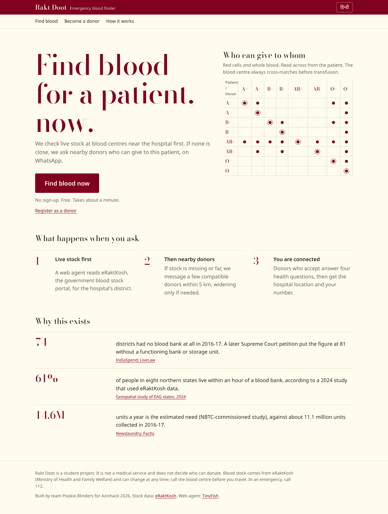
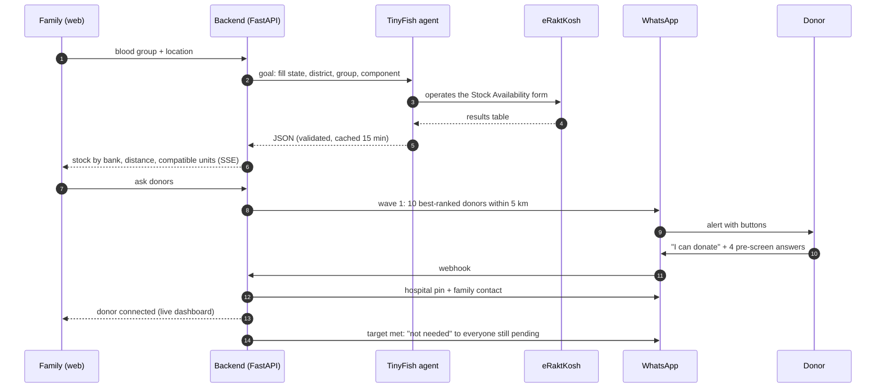
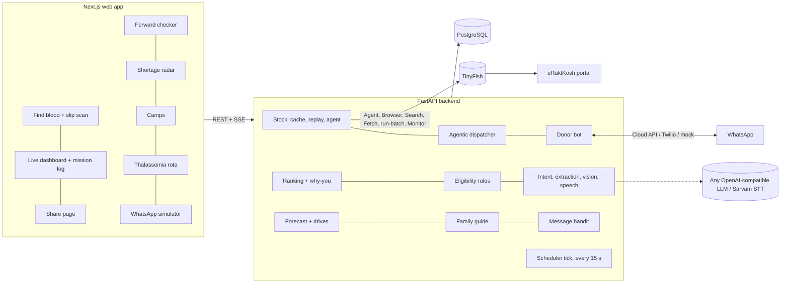
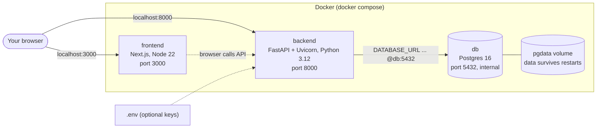
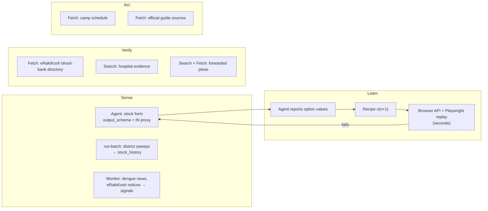
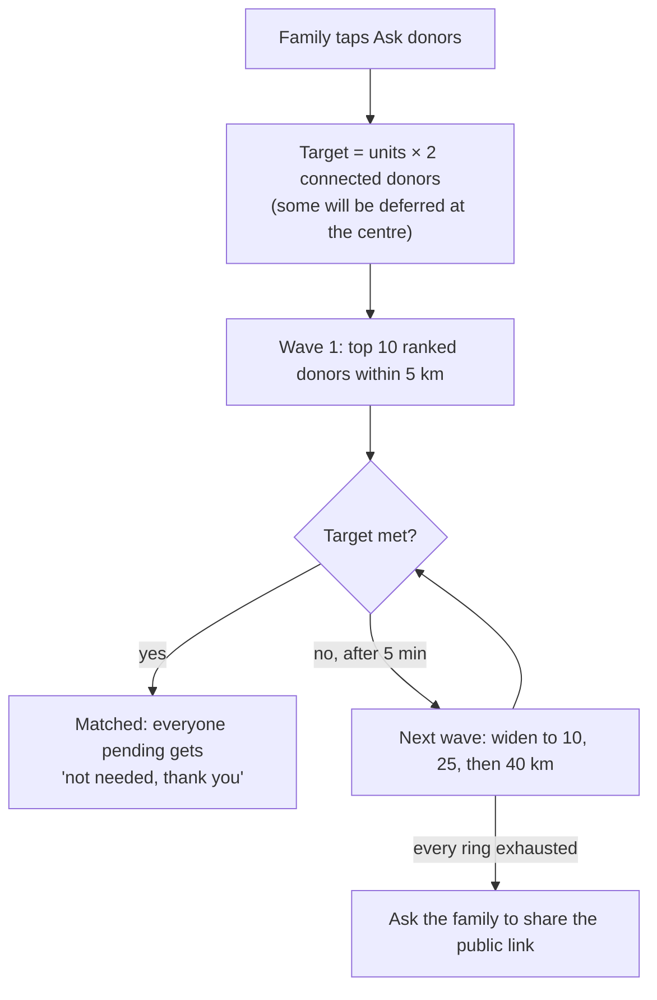
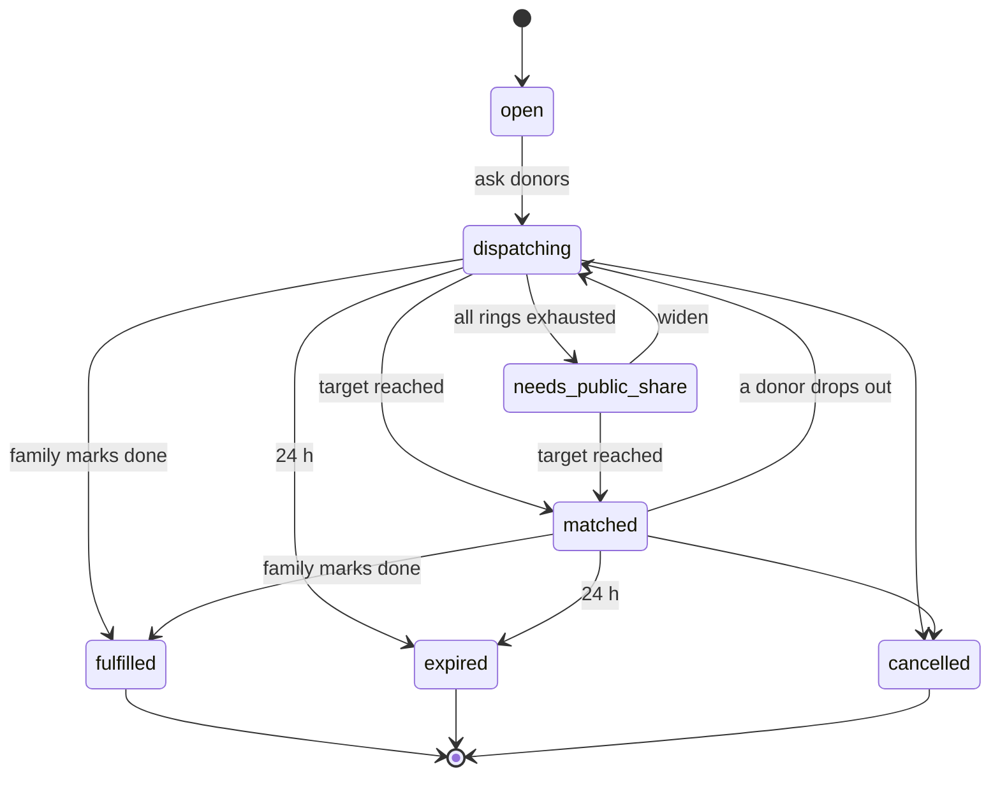

# Rakt Doot (रक्त दूत)

**Find blood in an emergency: live blood-bank stock first, nearby WhatsApp donors next.**

> Say what the patient needs, in any language, and Rakt Doot does the rest: live stock, verified hospitals, the right donors, and updates by voice.

When someone needs blood urgently in India, families end up begging on Instagram and forwarding pleas across WhatsApp groups. Blood centres publish their stock and lakhs of people are willing to donate, but nothing connects the two in the minutes that matter.

**Rakt Doot** connects them. A family member opens one page, or simply sends a WhatsApp voice note, and sees live stock at nearby blood banks, read from official blood-centre records by **TinyFish** web agents. If nothing close has stock, one tap alerts nearby donors on **WhatsApp**, but only those who are compatible, eligible today and not in their rest period. Donors never install an app, and they are never spammed.

Built by team **Pookie Blinders** (Kartik Tiwari, Utkarsh Singh, Raaghav Kapoor) for **Azinhack 2026**, IoSC, USAR GGSIPU. Track: AI Engineering. Sponsor tech: TinyFish.



> **New in this version:** blood components, a real eRaktKosh directory, an Agent-learns-Browser-replays TinyFish pipeline, a Shortage Radar, a Forward Checker for zombie and scam pleas, slip scanning, voice notes, an agentic dispatcher, a thalassemia rota, a message bandit, cited family guidance, camp placement and an AI benchmark. See [CHANGES.md](CHANGES.md) and [docs/eval_results.md](docs/eval_results.md).

---

## Contents

1. [The problem](#the-problem)
2. [How it works](#how-it-works)
3. [Architecture](#architecture)
4. [Quick start](#quick-start)
5. [Setup guide for teammates](#setup-guide-for-teammates)
6. [TinyFish integration](#tinyfish-integration)
7. [Where the AI is](#where-the-ai-is)
8. [Implementation details](#implementation-details)
9. [API reference](#api-reference)
10. [Project structure](#project-structure)
11. [Safety, privacy and legal](#safety-privacy-and-legal)
12. [Future scope](#future-scope)

---

## The problem

| Gap | What is wrong today |
|---|---|
| **Information** | Real-time stock exists for 3,800+ registered blood centres, but it is locked in desktop-era forms that nobody in a hospital corridor can use quickly. |
| **Connection** | Willing donors exist but cannot be targeted. Social-media pleas don't filter by blood group, distance or eligibility, and forwards keep circulating for weeks after the patient has been helped. |
| **Geography** | 74 districts had no blood bank at all in 2016-17 (IndiaSpend). In eight northern states, only about 61% of people live within an hour of one (2024 geospatial study using eRaktKosh data). |

India needs an estimated **14.6 million units** of blood a year (NBTC-commissioned study), against about **11.1 million** collected in 2016-17.

---

## How it works

**Family (phone browser, no install):**
1. Tap **Find blood now**, pick the blood group, share your location or search for the hospital.
2. A TinyFish agent reads eRaktKosh for that district. The page shows usable units for the patient's group and every compatible group, on a range map around the hospital.
3. If nothing close has stock, tap to ask donors. Fill in four fields, check the auto-written request (compatible groups are worked out for you) and send it.
4. A live dashboard shows how many donors were messaged, delivered, seen, replied and connected. A donor's number appears only after they accept and pass the health pre-screen.

**Donor (WhatsApp only):**
1. Send `JOIN` and answer eight short questions, once.
2. When someone nearby needs your group, you get one message with **I can donate** / **Not today** buttons.
3. After accepting, answer four yes/no health questions. If you pass, you get the hospital's location and the family's number.
4. After donating, you are silenced for your rest period (90 days for men, 120 for women) and told when you can donate again. `STOP` and `PAUSE 30` work at any time.



---

## Architecture

### System



### How Docker runs it

`python run.py` starts three containers from [docker-compose.yml](docker-compose.yml):



- `db` starts first. The backend waits until Postgres reports **healthy**.
- On first start the backend creates the tables and seeds **176 real Delhi NCR blood centres** (from eRaktKosh's public directory, geocoded), **200 synthetic donors**, sample camps, one synthetic thalassemia patient and the family-guide sources. Existing databases get new columns added automatically.
- Data lives in the `pgdata` volume, so it survives restarts. `python run.py --reset` wipes it.

| Layer | Choice |
|---|---|
| Frontend | Next.js 16 (App Router), React 19, plain CSS design tokens, self-hosted fonts, English and Hindi |
| Backend | Python 3.12, FastAPI, SQLAlchemy 2, Uvicorn |
| Database | PostgreSQL 16 (Docker). The same schema also runs on SQLite, which the test suite uses. |
| Web agent | TinyFish: Agent (SSE, structured output, IN proxy), Browser API + Playwright replay, Search, Fetch, run-batch, Monitor |
| Messaging | WhatsApp Business Cloud API, Twilio WhatsApp sandbox, or mock mode with a web simulator |
| LLM | Any OpenAI-compatible chat endpoint returning JSON (text and vision), with rules / samples as the fallback |
| Speech | Sarvam speech-to-text, any Whisper-compatible endpoint, or local faster-whisper |
| ML | Holt smoothing forecaster, Thompson sampling, BM25 retrieval (pure Python); optional scikit-learn / Intel sklearnex |
| Geocoding | OpenStreetMap Nominatim, with an offline fallback |

---

## Quick start

You need **Docker Desktop** and **Python 3** (Python only runs the launcher script).

```bash
git clone <this-repo-url> rakt-doot
cd rakt-doot
python run.py
```

| Open | What it is |
|---|---|
| http://localhost:3000 | The app |
| http://localhost:3000/simulator | Plays any donor's WhatsApp, for demos without a real WhatsApp account |
| http://localhost:3000/admin | Team controls (token: `change-me` by default) |
| http://localhost:8000/docs | Interactive API docs (Swagger) |

Press **Ctrl+C** to stop. The containers stop and your data is kept.

No API keys are needed. Without keys, the app runs end to end in demo mode: clearly labelled sample stock, synthetic donors and mock WhatsApp.

---

## Setup guide for teammates

### 1. First run

```bash
python run.py            # builds images (a few minutes the first time), then starts everything
```

`run.py` starts Docker Desktop if it isn't running, then runs `docker compose up --build`. You're ready when the log shows:

```
backend-1   | INFO:     Application startup complete.
frontend-1  | ✓ Ready
```

### 2. Try the whole flow in 2 minutes

Open two browser windows side by side.

1. **Window A:** http://localhost:3000, then **Find blood now**. Pick `B+` and search for `AIIMS`.
2. Sample stock appears. Tap **Ask nearby donors**, fill in the form (any valid 10-digit mobile number), then **Send to donors**.
3. You land on the **live dashboard**: 10 donors are messaged in wave 1.
4. **Window B:** http://localhost:3000/simulator. The donors who just got the alert are at the top. Open one, tap **I can donate**, then answer **No** to all four health questions.
5. Back in Window A, the donor shows as **connected**, with their number revealed.
6. In `/admin` (token `change-me`), **Pretend 3 hours passed** sends the "are you on your way?" message. **Pretend 25 hours passed** sends "did you donate?".

> **Demoing at night?** Between 11 pm and 7 am, only donors who opted in to night alerts are messaged, so waves can be tiny. Put `RESPECT_QUIET_HOURS=false` in `.env` and restart.

### 3. Configuration (`.env`)

Every key is optional. Copy the example and fill in only what you need:

```bash
cp .env.example .env     # Windows PowerShell: Copy-Item .env.example .env
```

| To switch on | Set in `.env` |
|---|---|
| Live eRaktKosh stock | `TINYFISH_API_KEY` |
| Real WhatsApp (Meta) | `WHATSAPP_MODE=cloud`, `WHATSAPP_TOKEN`, `WHATSAPP_PHONE_NUMBER_ID`, `WHATSAPP_APP_SECRET`, `WHATSAPP_VERIFY_TOKEN`. Webhook: `https://<api>/webhooks/whatsapp`. Register the templates in [docs/whatsapp-templates.md](docs/whatsapp-templates.md). |
| Twilio WhatsApp sandbox | `WHATSAPP_MODE=twilio`, `TWILIO_ACCOUNT_SID`, `TWILIO_AUTH_TOKEN`, `TWILIO_WEBHOOK_URL`. Webhook: `https://<api>/webhooks/twilio`. |
| LLM free-text parsing, extraction, dispatcher, guide | `LLM_API_KEY` (plus `LLM_BASE_URL` and `LLM_MODEL` for non-OpenAI providers) |
| Slip and donor-card reading | `VISION_MODEL` (a vision-capable model on the same endpoint) |
| Voice notes | Nothing: local Whisper runs in Docker. Optionally `STT_API_KEY` (Sarvam) or Whisper via `LLM_API_KEY`; `STT_PROVIDER` to force one |
| Voice replies | Nothing: free Edge voices by default. `TTS_PROVIDER`, `TTS_VOICE_EN`, `TTS_VOICE_HI`; `PUBLIC_API_BASE` for Twilio media links |
| Real camp portal | `CAMP_PORTAL_URL` (empty = built-in MOCK portal) |
| TinyFish tuning | `TINYFISH_PROXY_COUNTRY` (default `IN`), `TINYFISH_REPLAY_ENABLED`, `TINYFISH_VERIFY_EVERY`, `STOCK_SWEEP_HOURS`, `STOCK_SWEEP_DISTRICTS`, `TINYFISH_WEBHOOK_URL` + `TINYFISH_WEBHOOK_SECRET` |
| AI feature switches | `FORECAST_ENABLED`, `AUTO_DRIVES`, `DISPATCH_AGENT_ENABLED`, `MAX_ALERTS_PER_REQUEST`, `MAX_ALERTS_PER_REQUEST_PER_HOUR`, `BANDIT_ENABLED`, `USE_INTEL_SKLEARN`, `RECURRING_REMINDER_DAYS` |
| Late-night demo | `RESPECT_QUIET_HOURS=false` |
| Your own admin token | `ADMIN_TOKEN=<something secret>` |
| Dispatch tuning | `DISPATCH_WAVE_SIZE`, `DISPATCH_WAVE_INTERVAL_MIN`, `DISPATCH_RADII_KM` (default `5,10,25,40`) |

After changing `.env`, press **Ctrl+C** and run `python run.py` again. **Never commit `.env`**; it is already in `.gitignore`.

### 4. Everyday commands

| Task | Command |
|---|---|
| Start everything | `python run.py` |
| Start with a fresh database | `python run.py --reset` |
| Stop | **Ctrl+C** (or `docker compose stop` from another terminal) |
| What is running? | `docker compose ps` |
| Follow one service's logs | `docker compose logs -f backend` |
| Run the backend tests (136) | `docker compose run --rm --no-deps backend python -m pytest -q` |
| AI benchmark (writes docs/eval_results.md) | `docker compose run --rm --no-deps backend python -m eval.run` (add `--live` with keys) |
| Rebuild the blood-bank directory / guide sources | `python scripts/build_directory.py`, `python scripts/build_guide.py` (in `backend/`) |
| Train / compare the ranker | `docker compose run --rm --no-deps backend python scripts/train_ranker.py --synthetic 3000` |
| Re-seed with more donors | `docker compose exec backend python scripts/seed_donors.py --donors 1000` |
| Open the database | `docker compose exec db psql -U raktdoot` (then e.g. `select count(*) from donors;`) |
| Frontend type check | `cd frontend && npm install && npx tsc --noEmit` |

### 5. Making changes

- The containers run the code **as it was when the image was built**. After editing code, stop with Ctrl+C and run `python run.py` again. Only the changed parts are rebuilt.
- **Faster frontend loop (hot reload):** run only the database and API in Docker, and the UI locally:
  ```bash
  docker compose up --build db backend      # terminal 1
  cd frontend && npm install && npm run dev # terminal 2, http://localhost:3000
  ```
- Where to make a change:

  | I want to change… | Edit |
  |---|---|
  | Pages and UI | `frontend/app/<page>/page.tsx`, styles in `frontend/app/globals.css` |
  | UI text (English and Hindi) | `frontend/lib/i18n.tsx` |
  | WhatsApp message wording | `backend/app/services/messages.py` (then update `docs/whatsapp-templates.md`) |
  | Donor conversation flow | `backend/app/services/bot.py` |
  | Who gets alerted, and when | `backend/app/services/dispatch.py` |
  | Ranking weights | `backend/app/core/ranking.py` |
  | Health pre-screen questions | `backend/rules/eligibility.yaml` |
  | eRaktKosh agent instructions | `GOAL_TEMPLATE` and `STOCK_SCHEMA` in `backend/app/services/tinyfish_client.py` |
  | Replay recipe steps | `DEFAULT_STEPS` in `backend/app/services/replay.py` |
  | Database tables | `backend/app/models.py` (new tables are created and new columns added on startup; removing or retyping a column still needs `python run.py --reset`) |

- Run the tests before you push.

### 6. Troubleshooting

| Symptom | Fix |
|---|---|
| `failed to connect to the docker API` | Docker Desktop isn't running. Open it and wait for the whale icon to settle, or just rerun `python run.py`, which starts it. |
| `port is already allocated` / `address already in use` | Something else is using port 3000, 8000 or 5432. Stop it, or run `docker compose down` if an old Rakt Doot stack is still up. |
| Page says "Cannot reach the Rakt Doot server" | The backend isn't up yet, or has crashed. Check `docker compose logs backend`. |
| Wave sends 0 or very few donors | It's quiet hours (11 pm to 7 am). Set `RESPECT_QUIET_HOURS=false`. Otherwise each donor gets at most one alert a day, so run `python run.py --reset`. |
| Weird or old data | `python run.py --reset` |
| Code change not showing | Ctrl+C, then `python run.py` (images rebuild on start). |
| Stock says "sample" | Expected without `TINYFISH_API_KEY`. |

### 7. Setting it up with an AI coding assistant

If you use Claude Code, Cursor, Copilot or similar, open the repo and paste this:

```text
This repo is Rakt Doot: an emergency blood finder with a FastAPI backend (backend/),
a Next.js frontend (frontend/) and Postgres, all run by Docker Compose.
Read README.md first, especially "Setup guide for teammates".

1. Run `python run.py` from the repo root and wait until the backend logs
   "Application startup complete" and the frontend logs "Ready".
2. Check http://localhost:8000/api/health returns {"ok": true} and
   http://localhost:3000 loads.
3. Run the tests: `docker compose run --rm --no-deps backend python -m pytest -q`
   (expect 136 passed).
4. Do not commit .env or any API keys. Do not change docker-compose.yml
   unless I ask.
Report what you ran and the results.
```

Useful facts for the assistant:
- Backend entry point: `backend/app/main.py`.
- Settings: `backend/app/config.py`, read from `.env` in the repo root.
- Tests: `backend/tests/`. They use a temporary SQLite database, mock WhatsApp and demo TinyFish, so they need no keys.

---

## TinyFish integration

TinyFish is the data engine, organised as **Sense → Verify → Act → Learn**. Every call is logged (`tinyfish_runs`) and visible on `/admin`; the stock screen shows which path served it and how long it took.



**Lookup order:** cache → **replay** the learned recipe on the Browser API → **Agent** (and re-learn) → stale cache → unavailable (the family is offered donors at once). The emergency flow never waits on TinyFish.

| TinyFish API | Used for | Code |
|---|---|---|
| **Agent** (SSE, `output_schema`, `proxy_config` IN, stealth) | Live stock on eRaktKosh for one state + district + component, all groups at once; reports the option values it chose | `tinyfish_client.run_stock_agent` |
| **Browser API** + Playwright over CDP | Replays the learned route in a warm remote browser; self-heals through the Agent when it fails; every 20th replay is cross-checked by an Agent run | `services/replay.py` |
| **run-batch** + `runs.get` (+ run webhook) | District sweeps that build `stock_history` for the Shortage Radar | `tinyfish_client.batch_sweep` |
| **Monitor** | Topic monitor for dengue / platelet-shortage news and a Page monitor on eRaktKosh notices, feeding forecast signals | `/api/admin/tinyfish/monitors` |
| **Search** | Hospital verification with evidence; forwarded-plea phone checks | `verify_hospital`, `services/forwards.py` |
| **Fetch** | The real blood-bank directory, camp schedules, official family-guide sources, links inside forwards | `services/directory.py`, `camps.py`, `guide.py` |

**How "learn" works, honestly:** the replay step template mirrors the XHR calls that eRaktKosh's own Stock Availability page makes (district list, then the stock table, inside the site's origin and session). What drifts, and what the Agent learns, are the option codes for state, district and component, which it returns in its structured output after each successful run. A failed replay (non-JSON, empty table, unknown district, column change) falls back to the Agent and saves a new recipe version from that run. If the site changes structurally, replays keep failing, the recipe retires itself, and the Agent serves until the template is updated.

**Safeguards:** results cached per (state, district, component) for 15 minutes; one run per key in flight; 90 s Agent timeout and 45 s replay timeout; `validate_result` still checks every result ("COMPLETED does not mean success"); no personal data is ever read (directory emails and camp organiser names/phones are dropped); webhooks need a secret key and the payload is never trusted (the run is re-fetched by ID).

---

## Where the AI is

Measured numbers: [docs/eval_results.md](docs/eval_results.md), reproduced with `python -m eval.run`.

| Feature | Technique | Guardrail | Offline (no key) result |
|---|---|---|---|
| Intent parsing (F4 transcripts too) | LLM JSON, validated; keyword rules fallback | Never decides eligibility; < 0.7 confidence → buttons again | Rules: 81% accuracy on 201 labelled en/hi/Hinglish replies |
| Forward Checker (F2) | Shared extraction + signals (date age, repeat hashes, request match, hospital evidence, Search, scam patterns) | Never forwards a plea on; money asks are always flagged | 91% verdict accuracy, scam precision and recall 1.0 on 35 labelled pleas |
| Slip scan (F3), donor card (F9) | Vision LLM → validated JSON with per-field confidence | User confirms every field; image dropped after reading | Demo: stored parse of the sample slips |
| Voice-first requests (F4) | Speech to text (local Whisper, no key; or Sarvam / any Whisper API) → shared extraction → the bot asks only for what is missing → donors alerted → the family hears back on WhatsApp | Family confirms before any alert | Works offline in Docker; garbled speech ("SAF-DAR-JING hospital") still resolves |
| Voice replies (TTS) | Free Edge neural voices (hi-IN, en-IN), Sarvam bulbul, or any OpenAI-compatible TTS | Voice in → voice out; donors can send VOICE ON / VOICE OFF | Audio kept 7 days |
| Assisted camp registration (A2) | Form automation: reads the sign-up form, solves the captcha, submits, relays the OTP; TinyFish Agent for public portals | Explicit consent; Aadhaar used once, never stored, masked in logs | Demonstrated on a built-in MOCK portal with synthetic data |
| Agentic dispatcher (F5) | LLM picks from 8 safe actions | Donors only via the SQL filters; caps; O− policy check; rules fallback | Rules engine logs the same actions with reasons |
| Shortage Radar (F1) | Holt smoothing × weekday factor, normal risk | Synthetic history labelled; drives use emergency limits | MAE 5.9 vs 7.7 naive (red cells); shortage recall 0.26 vs 0.15 naive (red cells), 0.88 vs 0.35 (platelets); precision below naive. Synthetic data |
| Message bandit (F11) + why-you (F12) | Thompson sampling per segment; deterministic reason templates | Variants are separate approved templates | Picked the best wording in 18/20 simulated runs |
| Family guide (F13) | BM25 (+ embeddings, LLM composition with citations when keyed) | Official sources only; refuses out of scope; "ask the blood centre doctor" | 15/15 cited, 5/5 out-of-scope refused |
| Camp placement (F10), Intel (F14) | Coverage scoring + KMeans demand areas on Intel sklearnex | Venue coordinates labelled approximate | KMeans 7-8x faster on sklearnex (300k points) |
| Donor ranking | Transparent weighted score; LR upgrade path | Features logged per alert | AUC 0.750 heuristic vs 0.757 LR (synthetic) |

**The LLM never makes medical decisions.** Eligibility stays in [`rules/eligibility.yaml`](backend/rules/eligibility.yaml); the LLM only parses, explains, or picks from a fixed set of safe actions.

---

## Implementation details

### Blood compatibility

Red cells and whole blood below. See [`core/compatibility.py`](backend/app/core/compatibility.py), which is tested against an independent antigen rule for all 64 pairs. **Plasma** is the reverse on ABO (AB plasma suits everyone; RhD not matched) and **platelets** prefer ABO-identical with RhD-negative patients getting RhD-negative donors. Those two tables only decide whom to notify and must be **verified against NBTC / clinical guidance** before real use. O− donors are held in reserve for red-cell requests until the dispatcher releases them.

| Patient | Can receive from |
|---|---|
| O− | O− |
| O+ | O+, O− |
| A− | A−, O− |
| A+ | A+, A−, O+, O− |
| B− | B−, O− |
| B+ | B+, B−, O+, O− |
| AB− | AB−, A−, B−, O− |
| AB+ | all eight |

### Wave dispatch



A ring with nobody new in it is skipped at once. Requests close by themselves after 24 hours unless renewed.

### Request lifecycle



**Alert lifecycle:** `sent → delivered → read → accepted → connected → donated`, or `declined`, `ineligible`, `deferred`, `no_show`, `cancelled`. Two hours after connecting, the bot asks "are you on your way?"; a "no" reopens the waves. 24 hours after connecting, it asks "did you donate?".

### Who can be alerted

The donor must:
- have a compatible group;
- have consented, and not have opted out or paused;
- not have been alerted in the last 24 hours;
- be outside their rest period (by gender);
- be inside the radius;
- be aged 18 to 65;
- be outside quiet hours, unless they opted in to night alerts.

The rest period, pause, opt-out and 24-hour limit are **SQL conditions**, so a donor in rest cannot be selected even by mistake. Distance uses a bounding-box pre-filter on indexed lat/lng plus exact haversine. At national scale, switch to PostGIS `geography` with `ST_DWithin`.

### Pre-screen

Defined in [`rules/eligibility.yaml`](backend/rules/eligibility.yaml). The four questions ask about:
- alcohol in the last 24 hours;
- a tattoo or piercing in the last 12 months;
- fever, a cold or antibiotics right now;
- a donation in the last 3 months (men) or 4 months (women).

Our own donation records override a "no" to the last question. The values follow commonly cited NBTC guidance and must be checked against the current official guideline before going live.

---

## API reference

Full interactive docs are at http://localhost:8000/docs.

| Method | Path | Purpose |
|---|---|---|
| GET | `/api/stock/stream?lat&lng&group&component` | SSE: agent progress, then stock shaped for this patient and component |
| GET | `/api/components` | Compatibility tables per component |
| GET | `/api/places/search?q` | Hospital, area or pincode search |
| POST | `/api/requests` | Create a request; returns a private manage token |
| POST | `/api/requests/{id}/dispatch?t=` | Start the waves |
| GET | `/api/requests/{id}/events?t=` | SSE live dashboard |
| POST | `/api/requests/{id}/fulfil`, `/cancel`, `/extend`, `/widen` | Close, cancel, keep open 24 h, send the next wave now |
| GET | `/api/share/{slug}` | Public request page data, with no names or numbers |
| GET/POST | `/webhooks/whatsapp` | Meta verification and inbound messages (signature checked) |
| POST | `/webhooks/twilio` | Twilio inbound messages (signature checked) |
| `*` | `/api/mock/*` | Simulator; only when `WHATSAPP_MODE=mock` |
| POST | `/api/vision/slip` (file or `?sample=`) | Read a requisition slip into request fields with confidences |
| POST | `/api/voice/parse` (file or `?sample=`), `/api/extract` | Voice note or spoken text → request fields |
| POST | `/api/camps/{id}/register`, `/api/camps/registrations/{id}/otp` | Assisted camp registration |
| GET | `/api/media/{id}` | Voice replies (TTS audio) |
| GET/POST | `/mock-portal/...` | The MOCK camp sign-up portal (captcha, Aadhaar, OTP) used for the demo |
| POST | `/api/forwards/check`, `/api/forwards/{id}/alert` | Forward Checker verdict; consented request creation |
| GET | `/api/guide/ask?q&lang` | Cited family-guide answer or refusal |
| GET | `/api/radar?component` | Shortage risk per district and group |
| GET | `/api/camps`, `/api/camps/placement`, `/api/camps/placement.csv` | Upcoming camps; recommended camp sites |
| POST/GET | `/api/recurring`, `/api/recurring/{id}?t=`, `/api/recurring/demo` | Thalassemia rota |
| GET | `/api/samples/{name}` | Bundled sample slip / card / voice notes for demo mode |
| POST | `/webhooks/tinyfish?key=`, `/webhooks/tinyfish/monitor?key=` | TinyFish run and monitor webhooks |
| POST | `/api/admin/reset`, `/api/admin/tick` | Team controls (`X-Admin-Token` header) |
| GET/POST | `/api/admin/tinyfish`, `/tinyfish/sweep`, `/tinyfish/monitors`, `/directory/refresh`, `/camps/refresh`, `/guide/rebuild`, `/bandit`, `/bandit/simulate`, `/radar/backtest`, `/radar/drive` | TinyFish panel and AI controls |

---

## Project structure

```
rakt-doot/
├── run.py                 one command: starts the whole stack in Docker
├── docker-compose.yml     db (Postgres) + backend + frontend
├── .env.example           every optional setting, documented
├── backend/
│   ├── app/
│   │   ├── main.py        FastAPI app, startup seeding, scheduler
│   │   ├── api/           stock, requests, ai (slips, forwards, guide, radar, camps, rota), WhatsApp, admin
│   │   ├── core/          compatibility (per component), eligibility, ranking, explain (why-you), geo
│   │   ├── services/      tinyfish_client, replay, eraktkosh, directory, stock_history, forecast, dispatch,
│   │   │                  dispatch_agent, bandit, bot, extraction, vision, stt, forwards, guide, camps,
│   │   │                  camp_placement, recurring, whatsapp, llm, geocode, messages
│   │   ├── jobs/          ticker: dispatcher steps, expiry, follow-ups, eligible-again, rota, radar, sweeps
│   │   └── models.py      database tables
│   ├── data/              eRaktKosh directory snapshot, guide sources, SAMPLE slips/cards/voice notes
│   ├── eval/              AI benchmark: datasets + `python -m eval.run`
│   ├── rules/             eligibility.yaml (pre-screen rules)
│   ├── scripts/           seed_donors, train_ranker, build_directory, build_guide, make_samples, gen_templates
│   └── tests/             136 tests: mock-WhatsApp flows, recorded TinyFish runs, replay/heal, every AI module
├── frontend/
│   ├── app/               /, /find, /check, /radar, /camps, /recurring, /request/[id], /r/[slug], /donate,
│   │                      /how-it-works, /simulator, /admin
│   ├── components/        shared UI
│   └── lib/               API client, blood-group helpers, i18n (English and Hindi)
├── docs/                  screenshots, whatsapp-templates.md (generated), eval_results.md (generated)
└── CHANGES.md             what this upgrade built, changed and fixed
```

---

## Safety, privacy and legal

- **No money, ever.** Paid blood donation is banned in India. Nobody is paid and nobody is charged.
- **Not a medical device.** The pre-screen only avoids wasted trips. Every donation happens at a licensed blood centre that screens and cross-matches.
- **Consent and the DPDP Act 2023.** Donors opt in explicitly during onboarding. Their data is used only for emergency matching, kept to a minimum, and they can send STOP at any time.
- **Numbers stay private.** A family sees a donor's number only after that donor accepts and passes the pre-screen. The share page carries no names or numbers. The dashboard needs a private token.
- **Abuse limits.**
  - At most 3 open requests per phone number.
  - Hospital check via TinyFish Search.
  - Requests expire after 24 hours.
  - Each donor gets at most one alert a day.
- **Forwards are hashed.** The Forward Checker stores a hash of the text and of the phone number, never the raw plea; the reply masks the number.
- **Photos and voice notes are processed in memory and dropped** (`KEEP_UPLOADS=false`). Slips are downscaled on the phone first, which also strips location metadata.
- **No personal data from the web.** TinyFish reads public, non-personal pages only; directory emails and camp organiser names and phones are discarded at parse time.
- **No payment for blood, anywhere.** Pleas that ask for money, UPI or "transport charges" are flagged as possible scams.
- **Synthetic data.**
  - All seeded donors are synthetic and use the `9100000xxxxx` phone range, which no real Indian mobile can have. The WhatsApp service refuses to send to that range outside mock mode.
  - Blood-centre coordinates are geocoded from public addresses (most to the building, some to the locality); stock history for the radar, the demo thalassemia patient and sample camps are labelled synthetic or sample everywhere.

---

## Future scope

- An official eRaktKosh / NHM data partnership, inviting its registered donors to opt in
- Verified hospital dashboards
- Rare groups such as Bombay (bombaybloodgroup.org lists rare units; it needs an extended schema), via the ICMR Rare Donor Registry
- A second state stock source through the adapter layer (Assam SBTC's page was down when checked)
- IVR (phone calls) for feature phones, reusing the voice pipeline
- More regional languages
- Whisper on Intel OpenVINO for on-prem speech-to-text
- Real travel times from a routing engine
- The learned ranker and a learned forecaster, once real outcomes and stock history exist

---

## Team and licence

**Pookie Blinders**: Kartik Tiwari, Utkarsh Singh, Raaghav Kapoor. Released under the [MIT licence](LICENSE).
