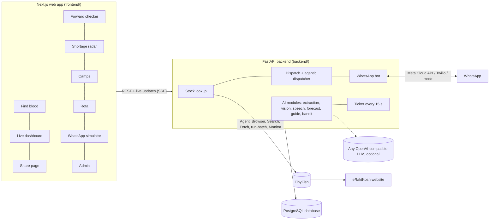

# Rakt Doot: the complete project guide

Read this file once, from top to bottom, and you will understand what Rakt Doot is, how every part works, and where to find it in the code. It is written in plain language. Technical words are explained the first time they appear, and there is a glossary at the end.

> This guide describes the code as it is in the working copy today, including the big upgrade (voice notes, Forward Checker, Shortage Radar, camps, thalassemia rota and the rest). That upgrade is listed in `CHANGES.md`. If your copy of the repo does not have files like `backend/app/services/replay.py` or `frontend/app/radar/`, you have an older version: pull the latest code first.

---

## Contents

1. [The story in one minute](#1-the-story-in-one-minute)
2. [The problem we are solving](#2-the-problem-we-are-solving)
3. [What Rakt Doot does](#3-what-rakt-doot-does)
4. [The big picture: how the pieces fit](#4-the-big-picture-how-the-pieces-fit)
5. [Running it on your laptop](#5-running-it-on-your-laptop)
6. [Journey 1: a family finds blood on the website](#6-journey-1-a-family-finds-blood-on-the-website)
7. [TinyFish integration (the most important part)](#7-tinyfish-integration-the-most-important-part)
8. [Journey 2: a donor on WhatsApp](#8-journey-2-a-donor-on-whatsapp)
9. [How donors are chosen and alerted (dispatch)](#9-how-donors-are-chosen-and-alerted-dispatch)
10. [Journey 3: a family asks by WhatsApp voice note](#10-journey-3-a-family-asks-by-whatsapp-voice-note)
11. [All the AI features, one by one](#11-all-the-ai-features-one-by-one)
12. [The background clock (ticker)](#12-the-background-clock-ticker)
13. [The database: every table](#13-the-database-every-table)
14. [WhatsApp: three ways to send messages](#14-whatsapp-three-ways-to-send-messages)
15. [Accounts (Supabase login)](#15-accounts-supabase-login)
16. [Every page in the web app](#16-every-page-in-the-web-app)
17. [Safety, privacy and legal rules](#17-safety-privacy-and-legal-rules)
18. [Settings (.env) cheat sheet](#18-settings-env-cheat-sheet)
19. [Tests and the AI benchmark](#19-tests-and-the-ai-benchmark)
20. [Honest limits and open risks](#20-honest-limits-and-open-risks)
21. [Where to change what](#21-where-to-change-what)
22. [Glossary](#22-glossary)

---

## 1. The story in one minute

It is 2 AM. A doctor tells a family that the patient needs B+ blood, now. Today that family starts calling people and forwarding messages on WhatsApp groups and Instagram. Those forwards keep going around for weeks, even after the patient has been helped.

**Rakt Doot** (Hindi for "blood messenger") fixes this in two steps:

1. **Stock first.** It checks live blood stock at blood banks near the hospital. That stock data is published by the government on a website called **eRaktKosh**, but eRaktKosh has no API (no clean way for a program to ask it questions). So we use **TinyFish**, a service that runs AI web agents in real browsers, to open eRaktKosh and read the stock for us, like a person would.
2. **Donors next.** If no blood bank close by has the blood, one tap sends a WhatsApp message to a few nearby donors. Only donors who **can** give to this patient, are **eligible today**, and are **not in their rest period** get the message. Donors never install an app. Nobody is spammed. Nobody pays or gets paid.

Everything else in the project (voice notes, the Forward Checker, the Shortage Radar and so on) grows out of these two steps.

---

## 2. The problem we are solving

| Gap | What goes wrong today |
|---|---|
| **Information** | eRaktKosh has live stock for 3,800+ registered blood centres, but it is a desktop-style form with dropdowns and no API. Nobody standing in a hospital corridor can use it quickly. |
| **Connection** | Many people are willing to donate, but there is no way to reach the right ones. Social media pleas don't filter by blood group, distance or eligibility. Old pleas keep circulating ("zombie forwards"), and some are scams asking for money. |
| **Geography** | 74 districts had no blood bank at all in 2016-17. In eight northern states only about 61% of people live within an hour of one. |

India needs about **14.6 million units** of blood a year but collected about **11.1 million** in 2016-17.

---

## 3. What Rakt Doot does

There are two main kinds of users.

**The family (the person who needs blood):**
- Opens one web page on their phone. No sign-up, no app.
- Picks the patient's blood group and the blood **component** (red cells, platelets, plasma or whole blood), and shares their location or searches for the hospital.
- Sees live stock at nearby blood banks on a map: units of the patient's own group **and** every group that is compatible.
- If nothing close has stock, taps "Ask nearby donors", checks an auto-written request, and sends it.
- Watches a **live dashboard**: how many donors were messaged, delivered, seen, replied, connected.
- Can also do all of this by **sending a WhatsApp voice note** in Hindi, English or Hinglish (see section 10).

**The donor:**
- Uses only WhatsApp. Sends `JOIN`, answers eight short questions once.
- When someone nearby needs their group, gets **one** message with two buttons: **I can donate** / **Not today**.
- After tapping "I can donate", answers four yes/no health questions. If they pass, they get the hospital location and the family's number, and the family gets theirs.
- After donating, Rakt Doot stays quiet for the rest period (90 days for men, 120 for women), then tells them they can donate again, often with a nearby blood donation camp.
- `STOP` and `PAUSE 30` work at any time.

**Extra features built on top** (each explained in section 11):

| Feature | One-line explanation |
|---|---|
| Blood components | Platelets, plasma and whole blood, not just red cells, each with its own compatibility rules. |
| Real blood-bank directory | 176 real Delhi NCR blood centres from eRaktKosh, with map locations. |
| Hospital verification | Checks that the hospital on a request is real, with evidence. |
| Forward Checker | Paste a forwarded blood plea; it tells you if it is old, already handled, unverified, genuine-looking or a possible scam. |
| Slip scan | Take a photo of the hospital's blood requisition slip; the form fills itself. |
| Voice notes | Families and donors can talk instead of type. Replies can come back as voice too. |
| Agentic dispatcher | An AI picks the next step for an open request from a fixed list of safe actions. |
| Shortage Radar | Forecasts which district and blood group will run short in the next 72 hours. |
| Thalassemia rota | A fair donor schedule for patients who need blood every few weeks. |
| Camps | Finds upcoming donation camps, suggests where to hold new camps, and can help a donor register. |
| Message bandit | Learns which alert wording gets the most "I can donate" taps. |
| "Why you" line | Each alert says why this donor was picked ("You're 2.1 km away and your group is an exact match."). |
| Family guide | Answers common questions with citations from official sources only. |
| Proof of donation | A photo of the donor card confirms a donation. |

---

## 4. The big picture: how the pieces fit



**In words:**
- The **frontend** is a Next.js website (React). It talks to the backend over normal HTTP and over **SSE** (server-sent events: the server keeps the connection open and pushes updates, which is how progress lines and the live dashboard update without refreshing).
- The **backend** is a Python FastAPI server. It holds all the logic: stock lookups, the WhatsApp bot, picking donors, AI features, and a background clock called the **ticker**.
- **TinyFish** is our window to the web: it reads eRaktKosh and other public pages for us.
- **PostgreSQL** stores everything. Tests use SQLite instead, with the same tables.
- **WhatsApp** is how donors (and optionally families) talk to us.
- An **LLM** (large language model) is optional. With no key, every AI feature falls back to rules, sample data or offline models, so the app always works.

**Tech stack:**

| Layer | What we use |
|---|---|
| Frontend | Next.js 16 (App Router), React 19, plain CSS, English and Hindi |
| Backend | Python 3.12, FastAPI, SQLAlchemy 2, Uvicorn |
| Database | PostgreSQL 16 in Docker (SQLite in tests) |
| Web agent | TinyFish Python SDK + REST API, Playwright for replays |
| Messaging | WhatsApp Business Cloud API, Twilio sandbox, or a mock with a web simulator |
| LLM | Any OpenAI-compatible endpoint (text and vision), with rule fallbacks |
| Speech | Local Whisper (no key), Sarvam, or any Whisper API; voice replies via free Edge voices, Sarvam or OpenAI |
| ML | Holt forecasting, Thompson sampling, BM25 search (pure Python); optional scikit-learn / Intel sklearnex |
| Maps | OpenStreetMap Nominatim, with an offline fallback |
| Login | Supabase (email + password) |

**Folder map:**

```
rakt-doot/
├── run.py                 one command: starts everything in Docker
├── docker-compose.yml     3 containers: db (Postgres), backend, frontend
├── .env.example           every optional setting, with comments
├── CHANGES.md             what the big upgrade built, changed and fixed
├── backend/
│   ├── app/
│   │   ├── main.py        creates the FastAPI app, seeds data, starts the ticker
│   │   ├── config.py      all settings, read from .env
│   │   ├── models.py      every database table
│   │   ├── api/           HTTP routes (stock, requests, ai, whatsapp, admin, auth, mock portal)
│   │   ├── core/          pure logic: compatibility, eligibility, ranking, why-you, geo
│   │   ├── services/      the real work: tinyfish_client, replay, eraktkosh, directory, dispatch,
│   │   │                  dispatch_agent, bot, whatsapp, forwards, forecast, recurring, camps, ...
│   │   └── jobs/ticker.py the background clock
│   ├── rules/eligibility.yaml   the health pre-screen questions and rest periods
│   ├── data/              real blood-bank directory snapshot, guide sources, sample slips and voice notes
│   ├── eval/              the AI benchmark (python -m eval.run)
│   ├── scripts/           seed donors, train ranker, rebuild directory/guide, generate templates
│   └── tests/             136 tests
├── frontend/
│   ├── app/               one folder per page (find, request, check, radar, camps, ...)
│   ├── components/        shared UI (header, voice button, slip scanner, guide panel, ...)
│   └── lib/               API client, blood helpers, English/Hindi text, login helpers
└── docs/                  screenshots, WhatsApp templates, benchmark results, this guide
```

---

## 5. Running it on your laptop

You need **Docker Desktop** and **Python 3**.

```bash
python run.py            # builds and starts db + backend + frontend
python run.py --reset    # same, but wipes the database first
```

| Open | What it is |
|---|---|
| http://localhost:3000 | The app |
| http://localhost:3000/simulator | Plays any donor's WhatsApp, for demos |
| http://localhost:3000/admin | Team controls (token `change-me` by default) |
| http://localhost:8000/docs | Interactive API docs |

**No keys are needed.** Without keys the app runs fully in **demo mode**: sample stock (clearly labelled "sample"), 200 synthetic donors, mock WhatsApp, rule-based AI. Every key in `.env` only switches a part from demo to live.

On first start the backend creates the tables and seeds: 176 real blood centres, 200 synthetic donors, sample camps, one synthetic thalassemia patient and the family-guide sources. If you already have an old database, new columns are added automatically on startup.

**Two-minute demo:** open `/find`, pick B+, search "AIIMS", tap **Ask nearby donors**, send. In a second window open `/simulator`, open a donor at the top, tap **I can donate**, answer **No** four times. Back on the dashboard the donor shows as connected. Between 11 pm and 7 am only night-opted donors are messaged, so set `RESPECT_QUIET_HOURS=false` for late demos.

---

## 6. Journey 1: a family finds blood on the website

This is the main flow. Follow it once and the rest of the project makes sense.

**Step 1: the family opens `/find`** (`frontend/app/find/page.tsx`). It is a 5-step wizard:
1. Blood group (or "not sure").
2. Component: red cells, platelets, plasma or whole blood. "Don't know" means red cells.
3. Location: share GPS, search a hospital or area, or type a pincode. There is also a **mic button** (speak the request) and a **scan slip** button (photo of the requisition slip).
4. Stock results.
5. Ask donors.

**Step 2: the browser asks for stock.** It opens `GET /api/stock/stream?lat=&lng=&group=&component=` (`backend/app/api/stock.py`). This is an SSE stream, so the family sees progress lines while the lookup runs.

**Step 3: coordinates become a district.** `locate()` turns the GPS point into an eRaktKosh **state + district** using OpenStreetMap reverse geocoding. If that fails, it uses the district of the nearest blood bank in our directory.

**Step 4: TinyFish gets the stock.** `tinyfish_client.lookup_stock(state, district, origin, emit, component)` is called. This is explained in full in section 7. It **never fails and never blocks**: the worst case is "unavailable", and the family is offered donors straight away.

**Step 5: the result is shaped for this patient.** `shape()` keeps only what the family needs: for each bank, units of the patient's exact group, units of every compatible group, total compatible units, distance and direction from the hospital. It also writes a summary: how many banks were checked, how many have stock, how far the nearest stock is. If no bank with stock is within **25 km**, the page suggests asking donors.

**Step 6: the page shows the results** on a range map (rings at 5, 10, 25, 50 km around the hospital) plus a list with "Directions" buttons. A small badge tells you how the data was served (replay, agent, cache, sample) and how long it took.

**Step 7: "Ask nearby donors".** The family fills four fields (units, patient age and gender, their name and phone) and sees the request text written for them, with compatible groups worked out automatically. `POST /api/requests` (`backend/app/api/requests.py`):
- refuses if this phone already has **3 open requests**;
- **verifies the hospital** with `verify_hospital()` (directory match + TinyFish Search, section 7.9) and stores the score and evidence;
- sets the **target**: `units × 2` connected donors, capped at 12. We over-recruit because some donors get deferred at the blood centre;
- sets the request to expire in **24 hours**;
- returns a private **manage token** (only the family can manage the request) and a public **share slug**.

**Step 8: dispatch starts.** `POST /api/requests/{id}/dispatch` sends wave 1 (section 9).

**Step 9: the live dashboard** (`/request/[id]`) streams from `GET /api/requests/{id}/events`. It shows the counters, donors who said yes (with their number only after they pass the pre-screen), the rings asked so far, a **mission log** of the dispatcher's decisions, the hospital check evidence, and the family guide. Buttons: share request, ask more donors now, blood arranged (close), cancel, keep open another 24 h.

**Step 10: the public share page** (`/r/[slug]`) shows the request with **no names and no phone numbers**, and says clearly when it is closed. This kills zombie forwards: anyone who opens an old link sees "closed".

---

## 7. TinyFish integration (the most important part)

### 7.1 What TinyFish is and why we need it

**TinyFish** is a service that runs **AI web agents** inside real cloud browsers. You give an agent a starting URL and a goal in plain English ("choose Delhi in the state dropdown, then..."), and it clicks, types and reads the page like a person would, then returns the result as JSON. TinyFish also offers a remote **Browser API** (a cloud Chrome you can drive yourself), **Search** (web search), **Fetch** (download pages as clean text), **run-batch** (many agent runs at once) and **Monitors** (scheduled checks).

**Why we need it:** eRaktKosh (`https://eraktkosh.mohfw.gov.in`) knows which blood bank has which blood right now, but it has **no public API**. Its "Stock Availability" page is a form with four dropdowns (State, District, Blood Group, Blood Component), a Search button and a results table. TinyFish turns that form into something our backend can call like an API.

We use TinyFish in four roles, called **Sense → Verify → Act → Learn**:

| Role | What it means | TinyFish API used |
|---|---|---|
| **Sense** | Read live stock, sweep many districts, watch the news | Agent, run-batch, Monitor |
| **Verify** | Check that hospitals and forwarded pleas are real | Search, Fetch |
| **Act** | Get camp schedules and official guidance | Fetch (and an Agent for camp sign-up on a public portal) |
| **Learn** | Learn the route through eRaktKosh once, then replay it fast | Agent + Browser API |

All of this lives mainly in `backend/app/services/tinyfish_client.py`, with helpers in `replay.py`, `eraktkosh.py`, `directory.py` and `stock_history.py`.

### 7.2 Live mode and demo mode

- **Live mode:** `TINYFISH_API_KEY` is set (and `TINYFISH_MODE` is not `demo`). Real calls to TinyFish.
- **Demo mode:** no key. `_demo_banks()` makes **sample stock** from our real directory: the 12 blood banks nearest to the hospital, with numbers from a hash of bank name + group + component + current hour. So the numbers look realistic, change every hour, and are the same for everyone in that hour. Negative groups and platelets are made scarcer on purpose. The API returns `sample: true` and the UI labels it "Sample stock".

Search, Fetch, batch and monitors simply return nothing in demo mode, and every caller handles that ("could not check").

### 7.3 The stock lookup, step by step

`lookup_stock(state, district, origin, emit, component)` is the heart of the project. It tries five things, in this order, and stops at the first that works:

```
1. cache          results for this (state, district, component) younger than 15 minutes
2. replay         run the learned recipe on a TinyFish cloud browser (a few seconds)
3. Agent          send the TinyFish web agent to fill the form (30-60 seconds), and re-learn
4. stale cache    older saved results, clearly marked as old
5. unavailable    no data; the family is offered donors immediately
```

Details:
- **One run per key at a time.** A lock per (state, district, component) means if 50 families in South Delhi search at once, TinyFish runs once and everyone gets the result.
- **Cache (15 minutes, `STOCK_CACHE_TTL_MIN`).** Stored in the `stock_cache` table. Because results are cached per district and India has about 780 districts, **cost grows with districts, not with users**. Sample results and live results never mix.
- **Progress lines.** `emit()` pushes messages like "Replaying the saved eRaktKosh route on a TinyFish browser." to the family's screen over SSE.
- **After success:** the result is saved to `stock_cache`, appended to `stock_history` (for the Shortage Radar), and returned with `served_by` (`cache`, `replay`, `agent`, `stale_cache`, `sample`, `none`) and the duration.
- **The emergency flow never waits on TinyFish.** Any error ends in stale cache or "unavailable" with `suggest_donor_search: true`.

### 7.4 The Agent: how we send TinyFish to eRaktKosh

`run_stock_agent()` starts one Agent run with:

- **url:** the eRaktKosh Stock Availability page.
- **goal:** `GOAL_TEMPLATE`, written as numbered steps a person could follow:
  1. Choose the state.
  2. Wait for the district list, choose the closest match (or "All").
  3. Choose "All Blood Groups" (one run covers all eight groups).
  4. Choose the component, using eRaktKosh's exact label ("Packed Red Blood Cells", "Random Donor Platelets", "Fresh Frozen Plasma", "Whole Blood").
  5. Click Search, read both the "Government Blood Banks" and "Other Blood Banks" tabs.

  It also tells the agent exactly what to return, to split the name, address and phone that eRaktKosh puts in one cell, to use 0 for "not available", to ignore the rare Bombay groups, and to **set `error`** if it sees a captcha, an error page or a block.
- **output_schema:** `STOCK_SCHEMA`, a JSON schema TinyFish uses to force the agent's answer into our shape: `banks` (max 25, each with name, address, phone, category, type, last_updated, availability_text and a `stock` object with a whole number per group), `district_selected`, `error`, and **`form_values`** (the hidden HTML option codes it picked for state, district and component; this is what the Learn step uses).
- **browser_profile: STEALTH**, so the site treats it like a normal browser.
- **proxy_config: India** (`TINYFISH_PROXY_COUNTRY=IN`), because government sites often behave better for Indian visitors. The TinyFish SDK only lists 7 countries, but the API accepts any country code, so `proxy_config()` widens the field in a small subclass.
- **Timeout:** 90 seconds (`STOCK_TIMEOUT_S`).

The agent **streams events** while it works, and we forward them to the family:

| Event | What we do |
|---|---|
| `StartedEvent` | Save the run ID, show "Agent opened eRaktKosh." |
| `StreamingUrlEvent` | Send the **live view URL** of the agent's browser to the UI |
| `ProgressEvent` | Show the agent's own description of what it is doing ("Selecting state Delhi") and count steps |
| `CompleteEvent` | If status is COMPLETED, take `result_json`; otherwise raise an error |

**"COMPLETED does not mean success."** A run can finish and still have failed (empty table, captcha, wrong shape). So every result goes through `validate_result()`:
- text instead of JSON → error;
- `error` field set → error;
- `banks` missing or not a list → error;
- empty banks and the words "captcha", "blocked" or "access denied" anywhere → "blocked";
- otherwise `_clean_banks()` keeps max 25 banks, trims every text, turns group labels like "B+Ve" into "B+", and drops any stock number that is not a whole number ≥ 0.

### 7.5 Learn and replay: making lookups fast

The Agent is flexible but slow (30-60 s). Once it knows the way, we can **replay** the same lookup in a few seconds. This is "Agent learns, Browser replays" (`services/replay.py`).

**What we found about eRaktKosh:** when you press Search on its page, the page itself makes two background calls (XHR):
1. `nearbyBB.cnt?hmode=GETDISTRICTLIST&selectedStateCode=<state code>` → the district list.
2. `nearbyBB.cnt?hmode=GETNEARBYSTOCKDETAILS&stateCode=..&districtCode=..&bloodGroup=all&bloodComponent=..` → the stock table as JSON.

**A recipe** is a list of steps stored as data in the `recipes` table (not code):

```
goto            the Stock Availability page (so we are inside the site's own origin and session)
xhr             fetch the district list for the state code
pick_district   find our district's code in that list
xhr             fetch the stock table for state + district + component codes
parse           turn the rows into banks (eraktkosh.parse_stock_rows)
```

**The codes are what drifts**, so that is what the Agent teaches. After every successful Agent run, `learn_from_agent()` takes `form_values` (state, district and component option codes, checked to be short numbers) and merges them into the recipe's `learned` data. Before any learning, the replay uses our own tables: `eraktkosh.STATE_CODES` (all states and union territories, e.g. Delhi = 97) and component codes (red cells 12, platelets 23, plasma 13, whole blood 11). District names are matched with `match_district()`, which handles things like "South Delhi" vs "South" and "Gurgaon" vs "Gurugram".

**How a replay runs** (`replay.run()`):
1. Get or reuse a **warm TinyFish Browser API session** (a cloud Chrome). Creating one costs 10-30 s, so a session is reused for **4 minutes**. A broken session is thrown away.
2. Connect to it with **Playwright over CDP** (the Chrome remote-control protocol).
3. Execute the recipe steps inside the page with the page's own `fetch` (same origin, same cookies, `X-Requested-With: XMLHttpRequest`).
4. Any surprise raises `ReplayError` and **never guesses**: response not JSON, district not in the site's list, no data table, rows present but none parsed (columns changed).
5. Timeout: 45 seconds.

**Self-healing:**
- If a replay fails, the lookup falls back to the Agent. When that Agent run succeeds, `learn_from_agent(..., healed=True)` saves a **new recipe version**, so the next lookup replays again.
- A recipe that fails 3 times (`FAILS_BEFORE_RETIRE`) without a success in the last 6 hours is **retired** (`active = false`). The Agent serves until it learns again.
- **Cross-check:** every 20th replay (`TINYFISH_VERIFY_EVERY`) also runs the Agent **in the background** (never on the family's path) and compares: the replay is OK if, for banks both found, at least 70% have identical stock. A mismatch counts as `verify_mismatch` and saves a fresh recipe version.
- Each recipe tracks `success_count`, `fail_count`, `verify_ok`, `verify_mismatch` and `last_ok_at`, all visible on `/admin`.

Honest limit: if eRaktKosh adds a captcha or a token to those background calls, replays will fail by design and the Agent will serve; the step template itself would then need a code update.

### 7.6 Matching banks to locations (the directory)

eRaktKosh's stock table has **no coordinates**, so we cannot draw it on a map or measure distance by itself. We fix this with a **directory** of real blood centres (`services/directory.py`, table `blood_banks`):

- **Source:** eRaktKosh's public Blood Bank Directory, covering Delhi, Gurugram, Faridabad, Gautam Buddha Nagar (Noida) and Ghaziabad. **176 real centres** ship in `backend/data/eraktkosh_directory.json`, so a fresh clone has them with no keys.
- **Geocoding:** each address was turned into a map point once with OpenStreetMap Nominatim (max 1 request per second, cached in `geocode_cache.json`). We try the cleaned name + city first, then locality parts, then the district. Any result **more than 40 km from the district's city is rejected** (Nominatim once placed some Max hospital branches 250-420 km away in other cities). Each bank stores `geo_quality` (geocoded, locality, district).
- **Live refresh:** `/admin` → "refresh directory" reads the directory again **through TinyFish Fetch**, geocodes new addresses (40 per click) and updates the table.
- **Matching** (`similarity()` and `best_match()`): each stock row is compared with every directory entry using a cleaned name (common words like "blood bank", "hospital", "govt" removed), name overlap and `difflib` similarity, **+0.35 if any phone number's last 8 digits match**, and up to **+0.15 for shared address words**. A score of 0.6 or more is a match. Unmatched names are counted and listed on `/admin`.
- Personal data: directory **emails are never kept**.

### 7.7 Stock history and district sweeps (Sense)

- **`stock_history`** (`services/stock_history.py`): every successful live lookup, replay or batch adds one row per (bank, group): units, source, time. This is the data the Shortage Radar learns from. Synthetic rows (for demos) are flagged and never mixed with real ones.
- **`batch_sweep()`** uses TinyFish **run-batch** (`POST https://agent.tinyfish.ai/v1/automation/run-batch`) to queue one Agent run per district (up to 100), each with the same goal, stealth profile and India proxy. It then polls each run with `runs.get` every 5 seconds (max 10 minutes), validates every result, and stores it in `stock_cache` + `stock_history`. Default districts: the 11 Delhi districts, Gurugram, Faridabad, Gautam Buddha Nagar and Ghaziabad (`STOCK_SWEEP_DISTRICTS`).
- Runs every `STOCK_SWEEP_HOURS` hours from the ticker (0 = only by hand from `/admin`), always off the family's path.

### 7.8 Monitors and webhooks (Sense)

- **Monitors** (`create_monitor()`, `POST /v1/monitors`): set up from `/admin`. A **Topic monitor** (a scheduled Search) watches news for dengue and platelet shortages, and a **Page monitor** (a scheduled Fetch) watches eRaktKosh notices. Monitors can only search and fetch; they cannot operate the stock form, which is why sweeps use run-batch instead.
- **Webhooks** (`backend/app/api/ai.py`):
  - `POST /webhooks/tinyfish?key=...`: a batch run finished. **We do not trust the payload**: we take only the run ID and **re-fetch the run from TinyFish with our own key**, then validate and store it.
  - `POST /webhooks/tinyfish/monitor?key=...`: monitor results. We keep only titles and URLs that match dengue/platelet or accident words, tag the district if one is named, and save them in the `signals` table for the radar.
  - Both need a secret `?key=` (`TINYFISH_WEBHOOK_SECRET`); without it they answer "not found". TinyFish webhooks are not signed, which is why we do this.

### 7.9 Search: hospital verification and forwards (Verify)

`search()` calls TinyFish Search with `location="IN"`, 10-second timeout. It returns `None` in demo mode or on failure, and callers treat that as "could not check".

**`verify_hospital(name, near, lat, lng)`** gives a score from 0 to 1 plus evidence:
- **Directory evidence (always):** best match in our directory. For hospital chains with many branches, a branch within 3 km of the claimed point is preferred (others are halved). Evidence includes the distance between the found branch and the claimed point.
- **Web evidence (live mode):** TinyFish Search for "<name> hospital <area>". A result counts if at least half of the hospital's name words appear in its title and snippet, with a bonus if the area matches. Up to 3 pieces of evidence with title and URL.
- **Verdict:** score ≥ 0.6 → verified; evidence but low score → not verified; no evidence and Search was down → `None` ("could not check").
- Shown on the dashboard, and used by the Forward Checker.

The Forward Checker also uses **Search on the phone number** in a plea and **Fetch on any link** inside it (section 11).

### 7.10 Fetch: reading public pages (Verify and Act)

`fetch()` downloads up to 10 URLs as markdown (150-second timeout). Used for:
- the **blood-bank directory** refresh (7.6);
- **camp schedules** (`services/camps.py`): eRaktKosh's public camp list, with **organiser names and phone numbers dropped** as personal data;
- the **family guide** sources (official pages only, section 11);
- **links inside forwarded pleas**.

### 7.11 Telemetry: every call is logged

`record_run()` writes every TinyFish call to the `tinyfish_runs` table: kind (agent, replay, search, fetch, batch, monitor), purpose, status, target, run ID, duration, steps, error. It never raises. `/admin` shows a TinyFish panel with these runs, the recipe versions and their counters, the unmatched banks, and buttons for sweep, monitors, directory refresh, camps refresh and guide rebuild. TinyFish's API does not expose credits per run, so we show duration, steps and run ID.

### 7.12 TinyFish safeguards, in one list

- Cache per (state, district, component) for 15 minutes; one run per key in flight.
- Agent timeout 90 s, replay 45 s, Search 10 s, Fetch 150 s.
- Every result validated; a finished run is not trusted to be a successful run.
- Structured output with a strict schema, then our own validation again.
- Replay never guesses: any surprise falls back to the Agent.
- Background cross-checks keep replays honest.
- Webhook payloads are never trusted; runs are re-fetched by ID.
- **No personal data is ever read from the web**: no directory emails, no camp organiser names or phones.
- The family's flow never waits on TinyFish.

### 7.13 TinyFish settings

| Setting | Default | Meaning |
|---|---|---|
| `TINYFISH_API_KEY` | empty | Empty = demo mode |
| `TINYFISH_MODE` | `auto` | `demo` forces demo even with a key |
| `ERAKTKOSH_STOCK_URL` | eRaktKosh stock page | Where the Agent starts |
| `STOCK_CACHE_TTL_MIN` | 15 | Cache lifetime |
| `STOCK_TIMEOUT_S` | 90 | Agent timeout |
| `TINYFISH_PROXY_COUNTRY` | `IN` | `off` = no proxy |
| `TINYFISH_REPLAY_ENABLED` | true | Use the learn-and-replay fast path |
| `TINYFISH_VERIFY_EVERY` | 20 | Cross-check every Nth replay |
| `STOCK_SWEEP_HOURS` | 0 | Automatic batch sweeps (0 = manual only) |
| `STOCK_SWEEP_DISTRICTS` | 15 NCR districts | `State/District` list |
| `TINYFISH_WEBHOOK_URL`, `TINYFISH_WEBHOOK_SECRET` | empty | Public webhook URL and its `?key=` |

### 7.14 How TinyFish is tested

There was no live key while building, so the live paths are tested with **recorded or faked responses**:
- `tests/test_tinyfish_live.py` replaces the SDK's network layer with recorded events (Started, StreamingUrl, Progress, Complete) and checks the full live path, including a run that "completes" with bad data.
- `tests/test_upgrade.py` covers replay, healing, recipe versions, validation, matching and more.

To measure real Agent vs replay speed, run with a key: `python -m eval.run --live --tinyfish 5`.

---

## 8. Journey 2: a donor on WhatsApp

All donor conversation logic is in `backend/app/services/bot.py`. Every incoming message (from Meta, Twilio or the simulator) goes to `handle_inbound()`. The current step of each conversation is stored in the `conversations` table (`state` + `data`), so a restart loses nothing.

**Commands that work any time:**

| Message | Effect |
|---|---|
| `JOIN`, `START`, `REGISTER`, `HI`, `HELLO` | Start onboarding |
| `STOP`, `UNSUBSCRIBE` | Opt out (also turns off WhatsApp consent on any linked web account) |
| `PAUSE 30` | No alerts for 30 days (any number) |
| `VOICE ON` / `VOICE OFF` | Get replies as voice notes too, or not |

**Onboarding (once):** after choosing a language (English or Hindi), eight questions: name, blood group, gender, date of birth, weight over 45 kg, location (share location or pincode), last donation date, and consent. Ages must be 18 to 65. (Night alerts are a donor setting, `night_ok`, that is off by default; the bot does not ask about it.)

**An alert arrives:** one message, e.g. "Someone near you needs blood. Group needed: B+. You are O+, so you can help. Hospital: ..., 3.5 km from you. Can you go and donate today?", plus the **why-you line** and two buttons.

**"I can donate" → the pre-screen.** Four yes/no questions from `backend/rules/eligibility.yaml`:
1. Alcohol in the last 24 hours?
2. Tattoo or piercing in the last 12 months?
3. Fever, cold or antibiotics right now?
4. Donated in the last 3 months (4 for women)?

Any "yes" means "not today" (deferred), with a kind message and often a nearby camp for later. Our own donation records override a "no" on the last question. Donors can answer in words ("nahi", "नहीं", "no yaar") and the **intent parser** (section 11) turns that into yes/no. **The AI never decides eligibility; the YAML rules do.**

**Pass → connected.** The donor gets the hospital location pin and the family's number; the family's dashboard shows the donor with their number. If the family used WhatsApp, they also get a message the moment a donor is on the way.

**Follow-ups** (by the ticker):
- 2 hours after connecting: "Are you on your way?" (On my way / Can't make it). "Can't" reopens the waves.
- 24 hours after: "Did you donate?" (Donated / Deferred at the centre / Couldn't go).
- "Donated" → the bot asks for a **photo of the donor card**. A readable, believable date sets `confirmed_by="photo"` and starts the rest period. Verified donors rank higher in the rota.

**When enough donors are connected**, everyone still pending gets "not needed any more, thank you". When the family closes the request, connected donors get a thank-you.

**Rest period over:** the donor gets "You can donate again", with the nearest upcoming camp and a **Register me** button (section 11).

---

## 9. How donors are chosen and alerted (dispatch)

Code: `backend/app/services/dispatch.py`, `dispatch_agent.py`, `core/ranking.py`, `core/compatibility.py`, `core/explain.py`, `services/bandit.py`.

### 9.1 Who can give to whom

Red cells and whole blood (`core/compatibility.py`, tested against an independent rule for all 64 pairs):

| Patient | Can receive from |
|---|---|
| O− | O− |
| O+ | O+, O− |
| A− | A−, O− |
| A+ | A+, A−, O+, O− |
| B− | B−, O− |
| B+ | B+, B−, O+, O− |
| AB− | AB−, A−, B−, O− |
| AB+ | all eight |

**Plasma** is reversed on ABO (AB plasma suits everyone) and ignores RhD. **Platelets** prefer the same ABO; RhD-negative patients get RhD-negative donors only. These two tables are simplified, only decide **whom to notify**, and **must be checked against NBTC/clinical guidance** before real use.

### 9.2 Who can be alerted (hard rules, in SQL)

`find_candidates()` only returns donors who:
- have a compatible group (and **not O−** if O− is in reserve, see 9.4);
- have consented, have not opted out, are not paused, weigh over 45 kg;
- were **not alerted in the last 24 hours**;
- are **outside their rest period** (90 days men, 120 days women/other);
- are inside the radius (fast box filter on indexed lat/lng, then exact distance);
- are aged 18 to 65;
- are not the requester and were not already alerted for this request;
- at night (11 pm to 7 am) opted in to night alerts.

These rules are **SQL conditions**, so a donor in rest cannot be picked even by a bug or by the AI.

### 9.3 Ranking

Each candidate gets a score from 0 to 1 (`core/ranking.py`):

| Feature | Weight | Meaning |
|---|---|---|
| Proximity | 0.35 | Closer is better |
| Group fit | 0.20 | Exact group 1.0, other compatible 0.6, O− for a non-O− red-cell patient 0.3 |
| Past response rate | 0.20 | Smoothed so a new donor starts at 0.5 |
| Reliability | 0.10 | Fewer no-shows is better |
| Time-of-day fit | 0.10 | Do they usually reply at this hour? |
| Freshness | 0.05 | Not alerted recently |

Every alert stores its features and outcome. `scripts/train_ranker.py` trains a logistic regression on these logs and compares it with the heuristic (AUC 0.757 vs 0.750 on synthetic data). One lower-ranked donor is added to each wave so new donors build a history.

### 9.4 Waves

- **Wave 1:** top 10 donors within **5 km** (`DISPATCH_WAVE_SIZE`, `DISPATCH_RADII_KM`).
- If the target is not met after **5 minutes**, the next wave widens to **10, 25, then 40 km**, plus two more waves at 40 km. An empty ring is skipped at once.
- **O− reserve:** O− blood suits every patient, so for red-cell requests from non-O− patients, O− donors are held back until released (wave 2+, a negative group, or 20+ minutes without enough donors).
- **Caps:** at most **60 alerts per request** and **30 per hour**.
- Target met → status `matched`, everyone pending gets "not needed". All rings used up → status `needs_public_share`, and the family is asked to share the public link.

Request statuses: `open → dispatching → matched → fulfilled`, or `needs_public_share`, `expired` (24 h), `cancelled`. A connected donor dropping out turns `matched` back into `dispatching`.

Alert statuses: `sent → delivered → read → accepted → connected → donated`, or `declined`, `ineligible`, `deferred`, `no_show`, `cancelled`.

### 9.5 The agentic dispatcher

Every 15 seconds the ticker asks the **dispatcher** (`dispatch_agent.py`) what to do next for each open request. It builds a small state (connected vs target, pending, wave, radius, time, alerts left, candidates in the next ring, cached stock) and picks **one** action from a fixed list:

`wait (1-30 min)` · `send_next_wave` · `widen_radius` · `include_o_negative` · `recheck_stock` · `suggest_camp` · `suggest_public_share` · `close_if_fulfilled`

- With an LLM key, the LLM chooses and writes a one-line reason a family can read. Its answer is validated: unknown actions are refused, `wait` is clamped to 1-30 minutes, O− release must pass the policy check, and "close" only works if the target is really met.
- Without a key, or on any error, **deterministic rules** decide, giving the same kind of action and reason.
- **The dispatcher cannot name, pick or message a donor.** Donors only come from `find_candidates()` with all the SQL rules and caps.
- Every decision is stored in `dispatch_decisions` and shown on the dashboard as the **mission log**.

### 9.6 The "why you" line and the message bandit

- **Why you** (`core/explain.py`): a deterministic one-liner from the ranking features and the radar, in English or Hindi: "You're 2.1 km away and B− is short in South Delhi today." No LLM.
- **Message bandit** (`services/bandit.py`): five alert wordings compete. **Thompson sampling** keeps a success/failure count per (wording, segment), where segment = language × first-time or repeat donor. Each alert picks a wording by sampling, so better wordings get used more while the others still get tried. Reward = the donor tapped "I can donate". Each wording is a separate approved WhatsApp template. Until Meta approves all five, run with `BANDIT_ENABLED=false`. In simulation it picked the best wording in 18 of 20 runs.

---

## 10. Journey 3: a family asks by WhatsApp voice note

A family can skip the website completely and send a WhatsApp **voice note** or text, for example "Papa ko B positive chahiye, Safdarjung hospital mein, do unit".

1. **Speech to text** (`services/stt.py`): local **Whisper** runs in Docker with no key. Optional: Sarvam (good for Indian languages) or any Whisper API. Audio is decoded in memory and dropped.
2. **Extraction** (`services/extraction.py`): one shared extractor pulls group, units, component, hospital, city, ward, urgency, date and phone, each with a confidence. The LLM extracts when a key is set, rules always run and fill gaps, and everything is validated: no blood group outside the eight, no phone outside Indian mobile format, units 1-12. It handles garbled speech ("SAF-DAR-JING hospital"), Devanagari and Hinglish words like "mein".
3. **The bot asks only for what is missing** (hospital, units, ...), one question at a time.
4. It shows **nearby stock** from the cache/sample path (the chat never waits on a live agent), then asks the family to **confirm**.
5. On confirm, a normal request is created (the sender's own number is the contact) and donors are alerted.
6. The family hears back on WhatsApp the moment a donor is on the way.

**Voice in, voice out:** if the family spoke, replies also come as voice notes (`services/tts.py`: free Edge neural voices `hi-IN-SwaraNeural` / `en-IN-NeerjaNeural`, or Sarvam, or OpenAI-compatible). Audio is kept 7 days, then deleted by the ticker.

The website has the same idea: a mic button on `/find` (browser speech recognition, with server speech-to-text as fallback).

---

## 11. All the AI features, one by one

**The golden rule: the AI never makes medical decisions.** Eligibility stays in `rules/eligibility.yaml`. The AI only reads, explains, or picks from fixed safe actions, and every feature works without any key.

### Intent parser (`services/llm.py`)
Turns a donor's free-text reply (English, Hindi, Hinglish) into an intent: accept, decline, eligibility answer, ETA update, location update, pause, question, stop or unknown. Uses the LLM with JSON output when keyed, keyword rules otherwise. Below 0.7 confidence the buttons are sent again. Rules alone: 81% accuracy on 201 labelled replies.

### Forward Checker (`services/forwards.py`, page `/check`, also in the bot)
Paste or forward a blood plea. Steps: extraction → signals → verdict.
- **Signals:** how old the date in the text is, how often we have seen this text or phone (stored as **hashes only**), whether it matches a Rakt Doot request, hospital verification, TinyFish Search on the phone number, TinyFish Fetch on any link, and **scam patterns** (money, UPI, "transport charges").
- **Verdicts:** `likely_stale`, `likely_fulfilled`, `unverified`, `looks_genuine`, `possible_scam`, with 1-4 reasons in English or Hindi. Money asks are always flagged.
- With the reporter's consent, a genuine plea can become a real request.
- 91% verdict accuracy and scam precision/recall 1.0 on 35 labelled pleas.

### Slip scan and donor card (`services/vision.py`, `components/ScanSlip.tsx`)
A photo of the hospital's requisition slip is shrunk on the phone (which also removes location metadata), then a vision model (`VISION_MODEL`) reads it into request fields with a confidence each. Low-confidence fields are highlighted for the user to check. The same pipeline reads donor cards for proof of donation (the date must be real, not in the future and not before the alert). Images are dropped after reading. Without a key, bundled sample images return a stored parse.

### Shortage Radar (`services/forecast.py`, page `/radar`)
Predicts, per district, component and group, the chance that usable stock falls below a threshold in the next 72 hours.
- Model: **Holt smoothing** (level + trend) on the daily district total, times a weekday factor. Risk = the probability the lowest forecast in 3 days drops below the threshold.
- The threshold is the configured units (default 5), but never more than a third of the series' usual level, so rare groups like AB− only flag when close to zero.
- It explains its factors, has a backtest, and can start a **donor drive** (a `kind="drive"` request with the same safety limits). `AUTO_DRIVES=true` starts drives automatically for risk ≥ 0.7.
- History comes from `stock_history`. Until a series has 14+ days of real data, a **clearly labelled synthetic history** is used (weekday dips, dengue season for platelets, festival dips). Real and synthetic are never mixed.

### Thalassemia rota (`services/recurring.py`, page `/recurring`)
Thalassemia patients need blood every few weeks. The rota assigns donors to dates **fairly**:
- Hard rules: compatible, consented, opted in to rotas (35% of synthetic donors), within max distance, age 18-65, rest period from every real or planned donation, at most 4 (men) or 3 (women) planned whole-blood donations a year, one slot per donor per date.
- Preferences: reliable, responsive, nearer donors; a penalty for donors already on the rota.
- The ticker reminds donors a few days ahead (Confirm / Can't), refills declined slots, and opens a normal request two days before any unfilled date.

### Camps (`services/camps.py`, `camp_registration.py`, `camp_placement.py`, page `/camps`)
- **Camp finder:** upcoming camps from eRaktKosh's public Camp Schedule via TinyFish Fetch (organiser names and phones dropped). Without a key, labelled sample camps near real blood centres. Used in the eligible-again message, deferral messages and the dispatcher's `suggest_camp`.
- **Assisted registration:** with the donor's consent, Rakt Doot fills the camp sign-up form with their JOIN details, solves the arithmetic captcha, submits, and relays the OTP the donor receives. **Aadhaar is asked at that moment, used once, never stored, and masked in chat logs.** The real eRaktKosh sign-up needs captcha + OTP + Aadhaar, so this is demonstrated on a **built-in MOCK portal** (`/mock-portal`, synthetic data, clearly labelled). Setting `CAMP_PORTAL_URL` + a TinyFish key switches to a TinyFish Agent filling a public portal. Works from WhatsApp (one tap on any camp suggestion) and from `/camps`.
- **Camp placement:** suggests where an NGO or college should hold its next camp. Score = 0.4 × donors within 5 km + 0.35 × radar shortage nearby + 0.25 × unmet requests nearby − 0.3 × overlap (a camp within 3 km or a blood centre within 1 km), with picks spread apart. Optional KMeans "demand areas", which run 7-8× faster on Intel Extension for Scikit-learn (`USE_INTEL_SKLEARN=true`). CSV export.

### Family guide (`services/guide.py`, `components/GuidePanel.tsx`)
Calm, **cited** answers to common family questions, from official pages only (eRaktKosh, DGHS/NBTC, a Delhi Government hospital page). Retrieval is **BM25** (keyword search, no key), optionally blended with embeddings. With an LLM key the answer is written from the retrieved passages only and must cite them. Anything outside the sources is refused, and personal medical questions end with "ask the blood centre doctor". 15/15 answers cited, 5/5 off-topic questions refused. Shown on the dashboard, `/how-it-works` and WhatsApp.

---

## 12. The background clock (ticker)

`backend/app/jobs/ticker.py` runs inside the backend every **15 seconds** (`TICKER_SECONDS`). All state is in the database, so each tick just looks for work that is due:

1. **Dispatch:** for each request due for its next step, check the target, then let the dispatcher (or plain `run_wave`) act.
2. **Expire** requests older than 24 hours (no zombie requests).
3. **"Are you on your way?"** 2 hours after a donor connects.
4. **"Did you donate?"** 24 hours after.
5. **Eligible again:** donors whose rest period just ended, with the nearest camp and a Register button.
6. **Rota:** reminders, gap requests, and moving each patient's schedule forward.
7. **Cleanup:** voice reply audio older than 7 days is deleted.

Also: the **Shortage Radar** refreshes every hour (and starts auto drives if enabled), and **batch sweeps** run every `STOCK_SWEEP_HOURS` when TinyFish is live.

`/admin` has "Pretend 3 hours passed" and "Pretend 25 hours passed" buttons to trigger follow-ups in demos.

---

## 13. The database: every table

All tables are in `backend/app/models.py`. New tables are created and **new columns are added automatically on startup** (no Alembic). Removing or retyping a column still needs `python run.py --reset`.

| Table | What it stores |
|---|---|
| `profiles` | Website accounts (Supabase user id, name, phone, language, WhatsApp consent, welcome status) |
| `donors` | Donors: group, gender, birth date, location, language, consent, pause, rest period data, response history, rota opt-in, voice preference, `synthetic` flag |
| `requests` | Blood requests: group, component, units, patient, hospital + verification, kind (`emergency` or `drive`), status, wave, radius, target, tokens, expiry |
| `notifications` | One row per alert sent: donor, wave, status, score, distance, features, pre-screen answers, wording variant, why-you reason, timestamps |
| `donations` | Confirmed donations and how they were confirmed (e.g. photo) |
| `blood_banks` | The directory: name, address, phone, location, district, state, category, eRaktKosh code, geocode quality |
| `stock_cache` | Latest stock per (state, district, component), with source and run ID |
| `stock_history` | Every stock observation, for the radar |
| `tinyfish_runs` | Every TinyFish call (telemetry) |
| `recipes` | Learned replay recipes with version and counters |
| `conversations` | Each WhatsApp chat's current step |
| `chat_messages` | Every WhatsApp message in and out |
| `camps` | Upcoming donation camps |
| `camp_registrations` | Assisted camp sign-ups and their steps |
| `mock_portal_entries` | The MOCK portal's own data (synthetic) |
| `forwards` | Checked pleas: hashes, extracted fields, verdict, reasons |
| `dispatch_decisions` | The dispatcher's mission log |
| `bandit_arms` | Wording statistics for the message bandit |
| `recurring_needs`, `recurring_slots` | Thalassemia rotas and their dates |
| `guide_chunks` | Family-guide passages |
| `media_files` | Voice reply audio (deleted after 7 days) |
| `signals` | News signals from TinyFish monitors |

---

## 14. WhatsApp: three ways to send messages

`backend/app/services/whatsapp.py` gives one `send()` function with three channels (`WHATSAPP_MODE`):

| Mode | What happens |
|---|---|
| `mock` (default) | Nothing leaves the server. `/simulator` plays any donor's phone. Best for demos and tests. |
| `cloud` | Meta WhatsApp Business Cloud API: real buttons, templates, location pins. Webhook `/webhooks/whatsapp` (signature checked). |
| `twilio` | Twilio WhatsApp sandbox: plain text, buttons become "Reply 1 / Reply 2". Webhook `/webhooks/twilio` (signature checked). |

**The 24-hour rule:** WhatsApp only allows free-form messages within 24 hours of the user's last message. Outside that window, business-started messages must be **pre-approved templates**. Our template texts are generated into `docs/whatsapp-templates.md` by `scripts/gen_templates.py`; register them with Meta before going live. The alert template is `blood_request_alert_v2`.

Every message in and out is logged in `chat_messages`. Synthetic donors use the `9100000xxxxx` number range, which no real Indian mobile can have, and the service **refuses to send to that range outside mock mode**.

---

## 15. Accounts (Supabase login)

Families can create an account at `/signup` and log in at `/login`. **Supabase** handles sign-up, passwords and sessions. Our backend only:
- checks the Supabase access token the browser sends (`get_current_user` in `backend/app/api/auth.py`);
- sends a one-time **WhatsApp welcome** to the account's number, if the user consented (`services/notifications.py`). Later features should send messages to account holders through `notify_user()`, which checks consent and never breaks the request if WhatsApp fails.

Settings: `SUPABASE_URL`, `SUPABASE_ANON_KEY` (backend) and `NEXT_PUBLIC_SUPABASE_URL`, `NEXT_PUBLIC_SUPABASE_ANON_KEY` (frontend). Finding blood **never** needs an account.

---

## 16. Every page in the web app

| Page | What it is |
|---|---|
| `/` | Home: "Find blood for a patient, now", the who-can-give-to-whom table, why this exists |
| `/find` | The 5-step wizard: group, component, location (mic, slip scan), stock, ask donors |
| `/request/[id]?t=` | The family's live dashboard (private token) |
| `/r/[slug]` | Public share page, no names or numbers |
| `/check` | Forward Checker |
| `/radar` | Shortage Radar: risk per district and group |
| `/camps` | Upcoming camps, registration, recommended camp sites |
| `/recurring` | Thalassemia rota: create and view a schedule |
| `/donate` | How to become a donor (opens WhatsApp with JOIN) |
| `/how-it-works` | Plain explanation plus the family guide |
| `/simulator` | Plays any donor's WhatsApp (mock mode only) |
| `/admin` | Team controls, stats, TinyFish panel, AI controls (token needed) |
| `/login`, `/signup` | Accounts |

All interface text is in English and Hindi (`frontend/lib/i18n.tsx`).

---

## 17. Safety, privacy and legal rules

- **No money, ever.** Paid blood donation is banned in India. Nobody pays, nobody is paid. Pleas asking for money are flagged as possible scams.
- **Not a medical device.** The pre-screen only avoids wasted trips. Licensed blood centres do the real screening and cross-match.
- **Consent (DPDP Act 2023).** Donors opt in explicitly, data is used only for matching, and STOP works any time.
- **Numbers stay private.** A family sees a donor's number only after the donor accepts and passes the pre-screen. The share page has no names or numbers. The dashboard needs a private token.
- **Abuse limits.** Max 3 open requests per phone, hospital verification, 24-hour expiry, max one alert per donor per day, max 60 alerts per request and 30 per hour.
- **Forwards are hashed**; the raw plea is not stored and numbers are masked in replies.
- **Photos and voice notes are processed in memory and dropped** (`KEEP_UPLOADS=false`).
- **No personal data from the web.** TinyFish reads public, non-personal pages only.
- **Aadhaar** is used once for camp sign-up, never stored, masked in logs.
- **Synthetic data is labelled everywhere**: donors, sample stock, radar history, sample camps, the demo thalassemia patient.

---

## 18. Settings (.env) cheat sheet

Copy `.env.example` to `.env` and fill only what you need. Every key is optional. After changing it, restart with `python run.py`. **Never commit `.env`.**

| To switch on | Set |
|---|---|
| Live eRaktKosh stock | `TINYFISH_API_KEY` (more in section 7.13) |
| Real WhatsApp (Meta) | `WHATSAPP_MODE=cloud`, `WHATSAPP_TOKEN`, `WHATSAPP_PHONE_NUMBER_ID`, `WHATSAPP_APP_SECRET`, `WHATSAPP_VERIFY_TOKEN` |
| Twilio sandbox | `WHATSAPP_MODE=twilio`, `TWILIO_ACCOUNT_SID`, `TWILIO_AUTH_TOKEN`, `TWILIO_WEBHOOK_URL` |
| LLM (intent, extraction, dispatcher, guide) | `LLM_API_KEY` (+ `LLM_BASE_URL`, `LLM_MODEL` for non-OpenAI) |
| Slip and card reading | `VISION_MODEL` |
| Voice notes | Nothing (local Whisper). Optional `STT_API_KEY` (Sarvam), `STT_PROVIDER` |
| Voice replies | Nothing (Edge voices). Optional `TTS_PROVIDER`, `TTS_VOICE_EN`, `TTS_VOICE_HI`, `PUBLIC_API_BASE` |
| Real camp portal | `CAMP_PORTAL_URL` (empty = MOCK portal) |
| Accounts | `SUPABASE_URL`, `SUPABASE_ANON_KEY`, `NEXT_PUBLIC_SUPABASE_URL`, `NEXT_PUBLIC_SUPABASE_ANON_KEY` |
| AI switches | `FORECAST_ENABLED`, `AUTO_DRIVES`, `DISPATCH_AGENT_ENABLED`, `BANDIT_ENABLED`, `USE_INTEL_SKLEARN`, `RECURRING_REMINDER_DAYS` |
| Dispatch tuning | `DISPATCH_WAVE_SIZE` (10), `DISPATCH_WAVE_INTERVAL_MIN` (5), `DISPATCH_RADII_KM` (5,10,25,40), `MAX_ALERTS_PER_REQUEST` (60), `MAX_ALERTS_PER_REQUEST_PER_HOUR` (30) |
| Late-night demos | `RESPECT_QUIET_HOURS=false` |
| Admin token | `ADMIN_TOKEN` |

---

## 19. Tests and the AI benchmark

- **136 backend tests** (`backend/tests/`), all passing. They use a temporary SQLite database, mock WhatsApp and demo/recorded TinyFish, so they need no keys. They cover the 64 compatibility pairs, eligibility, the full mock-WhatsApp flow from alert to connection, recorded TinyFish runs, replay and healing, and every AI module.

  ```bash
  docker compose run --rm --no-deps backend python -m pytest -q
  ```
- **AI benchmark:** `python -m eval.run` (inside `backend/`) writes `docs/eval_results.md`. Add `--live` with keys for real numbers. Offline highlights: intent rules 81%, Forward Checker 91%, guide 15/15 cited and 5/5 refused, bandit 18/20, radar beats a naive forecast on error.
- **Frontend type check:** `cd frontend && npm install && npx tsc --noEmit`.

---

## 20. Honest limits and open risks

- **Live TinyFish paths are only tested with recorded/faked responses**, because no key was available while building. Agent vs replay speed is "not measured" until someone runs the live benchmark. If eRaktKosh adds a captcha or token to its background calls, replays fail and the Agent serves (by design).
- **Plasma and platelet compatibility tables are simplified** and must be checked against NBTC/clinical guidance.
- **The radar runs on labelled synthetic history** until 14+ days of real stock history exist per series. The backtest proves the pipeline, not real accuracy.
- **WhatsApp templates must be approved by Meta** before live use. Keep `BANDIT_ENABLED=false` until all five alert wordings are approved.
- **TinyFish webhooks are not signed**, so we use a secret key and never trust the payload.
- **Assisted camp registration** is shown on a MOCK portal, because the real one needs captcha + OTP + Aadhaar.
- **One backend instance:** the ticker runs in-process. A tick during `/api/admin/reset` can log one `StaleDataError`, which fixes itself on the next tick.
- **Coverage is Delhi NCR** (the directory and default sweep districts). Other states work for stock lookups, but banks there have no map locations until the directory is extended.
- **Unmatched bank names** are kept in memory only and reset on restart.

---

## 21. Where to change what

| I want to change... | Edit |
|---|---|
| Pages and UI | `frontend/app/<page>/page.tsx`, styles in `frontend/app/globals.css` |
| UI text (English and Hindi) | `frontend/lib/i18n.tsx` |
| WhatsApp message wording | `backend/app/services/messages.py`, then `python scripts/gen_templates.py` |
| Donor conversation flow | `backend/app/services/bot.py` |
| Who gets alerted, and when | `backend/app/services/dispatch.py`, `dispatch_agent.py` |
| Ranking weights | `backend/app/core/ranking.py` |
| Health pre-screen questions | `backend/rules/eligibility.yaml` |
| eRaktKosh agent instructions | `GOAL_TEMPLATE` and `STOCK_SCHEMA` in `backend/app/services/tinyfish_client.py` |
| Replay steps | `DEFAULT_STEPS` in `backend/app/services/replay.py` |
| eRaktKosh codes and parsers | `backend/app/services/eraktkosh.py` |
| Blood-bank directory | `python scripts/build_directory.py` (in `backend/`) |
| Family-guide sources | `python scripts/build_guide.py` (in `backend/`) |
| Database tables | `backend/app/models.py` |

Run the tests before you push.

---

## 22. Glossary

| Word | Meaning |
|---|---|
| **eRaktKosh** | The Government of India's (MoHFW) blood bank portal with live stock, a blood bank directory and camp schedules |
| **TinyFish** | A service that runs AI web agents in cloud browsers, plus Browser API, Search, Fetch, run-batch and Monitors |
| **Agent** | A TinyFish AI that operates a website from a plain-English goal |
| **Browser API** | A remote Chrome from TinyFish that our code drives with Playwright |
| **Playwright** | A library to control a browser from code |
| **CDP** | Chrome DevTools Protocol, how Playwright talks to a remote Chrome |
| **XHR** | A background request a web page makes to load data without reloading |
| **Recipe** | Our saved list of replay steps plus learned option codes, versioned in the database |
| **Replay** | Running a recipe on the Browser API instead of sending the Agent (seconds instead of a minute) |
| **output_schema** | A JSON schema that forces the Agent's answer into our exact shape |
| **Stealth profile** | A TinyFish browser setting that makes the agent look like a normal browser |
| **Proxy (IN)** | Sending the agent's traffic through India |
| **SSE** | Server-sent events: the server pushes live updates over an open connection |
| **Component** | Which part of blood is needed: red cells (PRBC), platelets, plasma or whole blood |
| **Wave** | One round of donor alerts at a given radius |
| **Target** | How many connected donors a request needs (units × 2, max 12) |
| **Rest period** | Minimum days between whole-blood donations: 90 for men, 120 for women |
| **Pre-screen** | The four yes/no health questions before a donor is connected |
| **O− reserve** | Holding back universal O− donors until other donors have had a chance |
| **Dispatcher** | The part that decides the next action for an open request |
| **Thompson sampling** | A way to try several options and learn which works best while still exploring |
| **Holt smoothing** | A simple forecasting method that tracks a level and a trend |
| **BM25** | A classic keyword search ranking method |
| **Template (WhatsApp)** | A Meta-approved message needed to message someone outside the 24-hour window |
| **Mock mode** | WhatsApp messages stay inside the app and appear in `/simulator` |
| **Demo mode** | No keys: sample stock, rules instead of LLMs, mock WhatsApp |
| **Synthetic** | Made-up data for demos, always labelled |
| **Zombie forward** | An old plea still being forwarded after the need is over |
